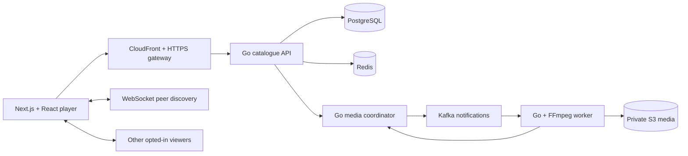

# PeerShare

A video platform for watching, publishing and sharing. Creators upload an MP4, add artwork and publish to their own channel. Viewers discover videos, follow creators and build private or public playlists. Optional peer delivery lets browsers share verified video segments while HTTP remains available.

## What you can do

- **Publish your work.** Resumable uploads, a private preview, adaptive 480p/720p playback, custom thumbnails and channel banners, searchable Studio, and separate draft, published and unpublished collections.
- **Find your next watch.** Search titles, creators and tags across the catalogue. Browse topics, visit channels and follow creators for a personal feed.
- **Keep a collection.** Create private or public playlists, arrange their order and play through a queue.
- **Watch together.** Custom player controls, quality selection and optional WebRTC segment sharing. Connection details show actual received and uploaded media payload.
- **Understand your channel.** Creator analytics show playback, delivery and quality signals. Redis caches analytics as well as enforcing rate limits; PostgreSQL remains the source of truth.
- **Operate the platform.** A role-restricted workspace shows real processing jobs and reserved storage, with audited retry/cancel actions.
- **Use your own account.** Email/password and Google OIDC sign-in share database-backed sessions and channel ownership. Existing accounts connect Google explicitly from Settings.

The populated showcase contains 18 original visual explainer videos across six editorial channels. Those are showcase accounts, not claimed customer adoption. The load-test dataset is separate from public content.

## How it works



The catalogue owns accounts, channels, publication, subscriptions and playlists. A separate media service coordinates encoding over authenticated gRPC. Workers produce HLS renditions, artwork and segment hashes. The browser verifies segments before using them, whether they came from HTTP or a peer. CloudFront serves the static frontend; authorized API/media requests reach the Go application without shared caching.

## Run locally

Use Node 22, Docker Compose and Go 1.27.2. FFmpeg is required for native media generation. Dependencies are pinned in the repository.

```sh
npm ci
npm run fixture
npm run compose:demo
```

Open [the local application](http://localhost:3000). This starts the frontend, catalogue API, media coordinator, worker, PostgreSQL, separate Redis instances and Kafka. Upload an MP4 from Studio after creating an account and channel. Re-running the command retains normal application data.

For native development, use `npm run deps`, `npm run migrate` and `npm run dev`. The [development guide](docs/runbooks/demo-and-handoff.md) explains runtime choices and the creator/viewer walkthrough.

## Learn the project

The [documentation index](docs/README.md) maps product journeys to their implementation guides.

The guides explain what each component does, how it is used and why it was chosen:

| Topic                                          | Guide                                                                    |
| ---------------------------------------------- | ------------------------------------------------------------------------ |
| Data modelling, Go, APIs and React foundations | [Phase 1](docs/learning/phase-1/README.md)                               |
| Uploads, media formats, HLS and publishing     | [Phase 2](docs/learning/phase-2/README.md)                               |
| Service ownership, gRPC and Kafka              | [Phase 3](docs/learning/phase-3/README.md)                               |
| Following, playlists and creator analytics     | [Phase 4](docs/learning/phase-4/README.md)                               |
| Google OIDC, artwork and player components     | [Identity and product guide](docs/learning/product-and-google/README.md) |
| AWS, HTTPS, STUN, Redis and observability      | [Phase 5](docs/learning/phase-5/README.md)                               |
| Kubernetes, product finish and measurement     | [Phase 6](docs/learning/phase-6/README.md)                               |
| Design system and frontend component map       | [UI design](docs/learning/ui-design.md)                                  |

## Measured performance

An isolated catalogue containing **100,000 video records and 10,000 synthetic accounts** sustained **200 offered operations/sec** across three two-minute runs: **72,002 validated operations, p95 ≤55 ms, p99 ≤99 ms, zero failures and zero dropped iterations**. The application ran on the existing 2-vCPU, 8-GiB Mumbai host; an external workstation generated load through a private tunnel. This measures the documented API mix, not concurrent video viewers or maximum server capacity.

The campaign also records failing stress levels, recovery, Redis cache behavior and real 720p/1080p media processing. Read the [benchmark protocol](docs/benchmarks/protocol.md), [report](docs/benchmarks/report.md) and [learning guide](docs/learning/phase-6/04-benchmarking-a-video-system.md) before quoting numbers. Historical evidence stays tied to the exact release and workload measured.

## Deployment and operations

The AWS deployment uses a single Mumbai host, private S3, immutable images, an HTTPS gateway and CloudFront. The account remains on its Free plan with a bounded demo lifetime. Public routing is being moved to **peershare.darshpatel.dev**; the existing infrastructure identifiers remain compatible with stored data.

Use [the deployment runbook](docs/runbooks/aws-deployment.md) and [cost plan](docs/runbooks/aws-cost-plan.md) for operating the host. `npm run operations` adds private Grafana, Prometheus and Jaeger. The [observability guide](docs/learning/phase-5/06-observability.md) connects those signals to upload processing, playback and API traffic. `npm run kube -- up` runs the separate local Helm/kind exercise; it does not provision EKS.

## Validation and scope

```sh
npm run check
npm run contracts:check
npm run proto:check
npm run api:vet
npm run test:integration
npm run test:browser
```

Run dependency-based suites sequentially: they share a disposable test project. The normal application data is retained. Targeted gateway, S3, monitoring and recovery exercises are documented in the runbooks; they support the product workflows above. The [review resolution](docs/reviews/2026-10-15-review-resolution.md) records the latest creator-library, processing and playlist fixes.

This deployment has one host/database/broker as shared failure domains. It does not claim multi-host availability. Public registration is closed and publishing requires creator approval. Password recovery and email verification remain future account features. Peer delivery depends on browser and network connectivity; STUN assists address discovery, and the application does not currently operate a TURN relay. Native HLS has different measurement capabilities from the verified Chromium path.

Some database, cookie, environment, protocol and AWS resource identifiers retain the original `peerscreen` prefix to preserve existing data and integrations. PeerShare is the product name; historical evidence and the original supplied brief retain their original names and release references.
