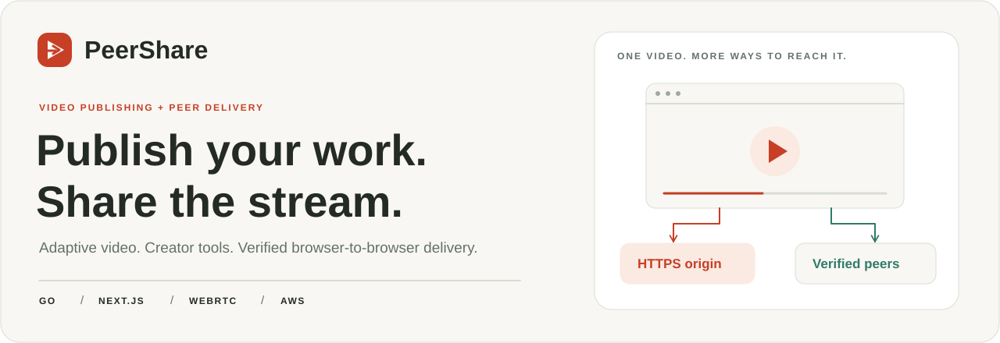
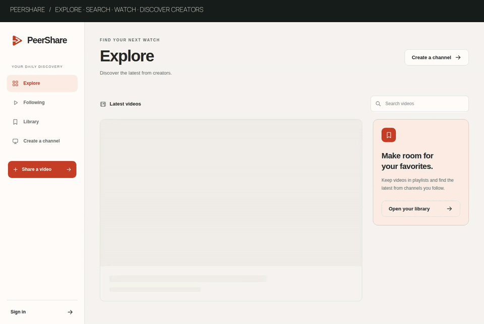
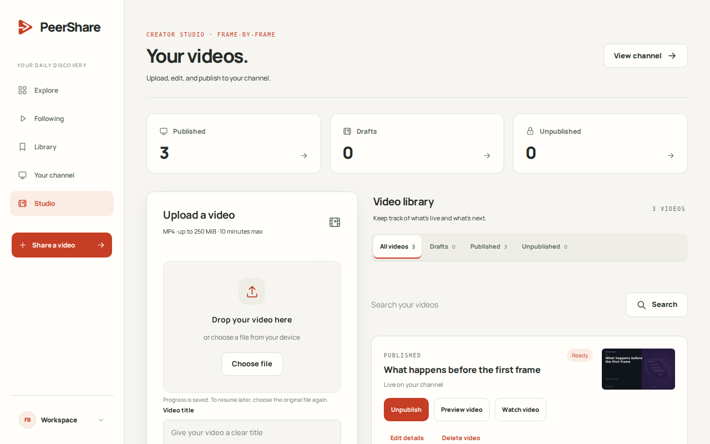
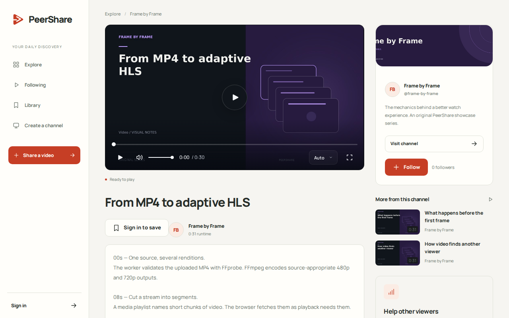
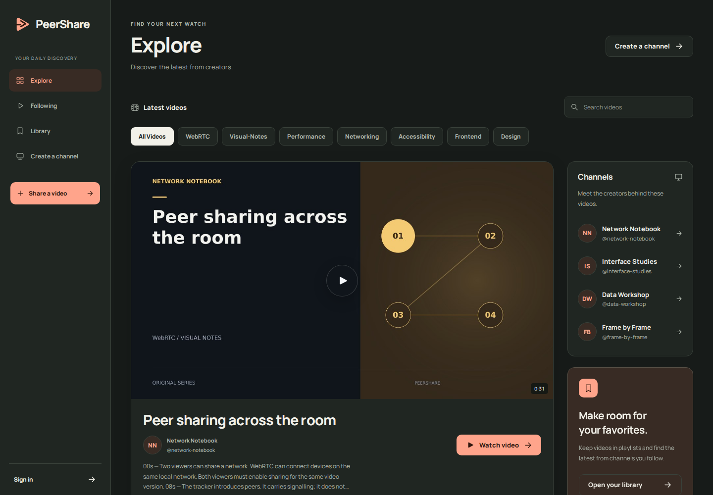
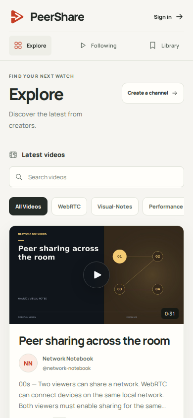
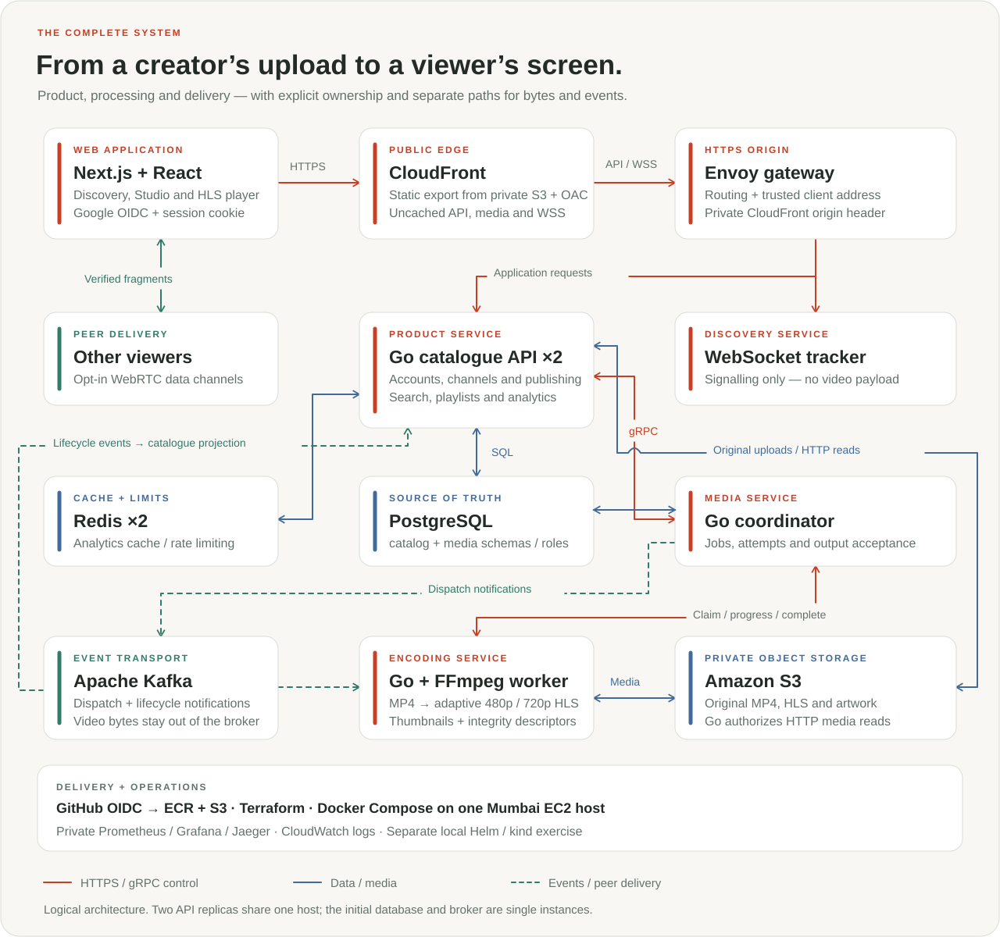
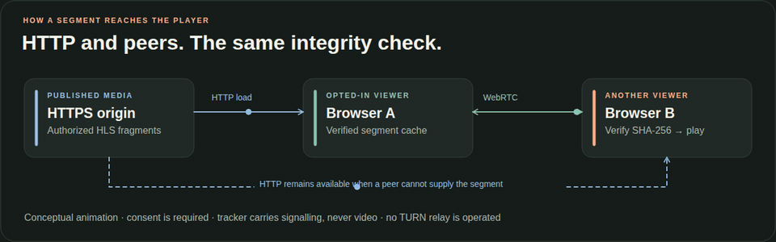
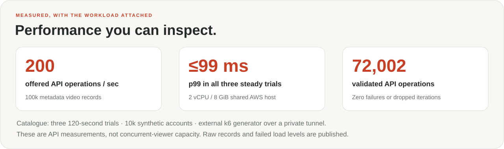

<picture>
  <source media="(prefers-color-scheme: dark)" srcset="docs/assets/readme/hero-dark.svg">
  
</picture>

<p align="center">
  <a href="https://peershare.darshpatel.dev"><strong>Open PeerShare ↗</strong></a>
  &nbsp; · &nbsp;
  <a href="#quickstart">Quickstart</a>
  &nbsp; · &nbsp;
  <a href="#architecture">Architecture</a>
  &nbsp; · &nbsp;
  <a href="#measured-performance">Benchmarks</a>
  &nbsp; · &nbsp;
  <a href="docs/README.md">Learning guides</a>
</p>

<p align="center">
  <a href="https://github.com/darshpatel1052/PeerShare/actions/workflows/ci.yml"></a>
</p>

**A video-on-demand platform built with Go, Next.js and WebRTC.** Upload an MP4, make your channel your own and publish adaptive video. Discover creators, build playlists and watch through a custom player. When viewers choose to share, their browsers exchange verified video segments directly while HTTP remains available.

## See it in action

<picture>
  <source media="(prefers-reduced-motion: reduce)" srcset="docs/evidence/phase-6/peershare-product/explore-desktop.png">
  
</picture>

<sub>Recorded from the running local application. The hosted showcase has 18 original visual explainers across six editorial channels, alongside the owner's original video. Showcase accounts are identified as editorial; the benchmark dataset stays separate.</sub>

## Built for creators and viewers

<table>
  <tr>
    <td width="50%" valign="top">
      <h3>Publish your work</h3>
      <p>Resumable MP4 uploads, private previews and adaptive 480p/720p HLS. Add a thumbnail, edit metadata and manage your full library in Studio.</p>
    </td>
    <td width="50%" valign="top">
      <h3>Watch your way</h3>
      <p>A custom player with quality selection, keyboard controls, seeking and fullscreen. Opt into peer delivery and see actual received and uploaded payload.</p>
    </td>
  </tr>
  <tr>
    <td valign="top">
      <h3>Find your next watch</h3>
      <p>Search titles, creators and tags. Explore real topics, visit channels and follow creators for a personal feed.</p>
    </td>
    <td valign="top">
      <h3>Make it yours</h3>
      <p>Custom channel banners, private or public playlists, ordered playback queues and light/dark appearance. Google and email sign-in share the same account ownership.</p>
    </td>
  </tr>
  <tr>
    <td valign="top">
      <h3>Understand your channel</h3>
      <p>Creator analytics report qualified plays, watch time and delivery signals. PostgreSQL owns the data; Redis caches aggregates and enforces rate limits.</p>
    </td>
    <td valign="top">
      <h3>Run the platform</h3>
      <p>A role-restricted operator workspace shows actual processing jobs and storage. Private dashboards connect API traffic, traces and media work.</p>
    </td>
  </tr>
</table>

<details>
<summary><strong>Look around — Studio, player, dark mode and mobile</strong></summary>
<br>
<table>
  <tr>
    <td width="50%" align="center"><strong>Creator Studio</strong><br><br><a href="docs/assets/readme/studio.png"></a></td>
    <td width="50%" align="center"><strong>Custom video player</strong><br><br><a href="docs/assets/readme/player.png"></a></td>
  </tr>
  <tr>
    <td align="center"><strong>Dark appearance</strong><br><br><a href="docs/evidence/phase-6/peershare-product/explore-dark.png"></a></td>
    <td align="center"><strong>Made for smaller screens</strong><br><br><a href="docs/evidence/phase-6/peershare-product/explore-mobile.png"></a></td>
  </tr>
</table>
</details>

## Architecture

The product has three Go executables with distinct responsibilities: the **catalogue API** owns the user-facing platform, the **media coordinator** schedules processing and accepts outputs, and the **worker** runs FFmpeg. Kafka carries notifications; video bytes live in private object storage.

<picture>
  <source media="(prefers-color-scheme: dark)" srcset="docs/assets/readme/architecture-dark.svg">
  
</picture>

<p align="center">
  <a href="docs/assets/readme/architecture-light.svg">Open full-size SVG</a>
  &nbsp; · &nbsp;
  <a href="docs/learning/phase-3/01-architecture-and-ownership.md">Service boundaries</a>
  &nbsp; · &nbsp;
  <a href="docs/learning/phase-3/02-data-and-transactions.md">Data model</a>
</p>

1. **Publish.** The API receives source uploads and submits a media job over authenticated gRPC. Kafka notifies a worker, which creates HLS renditions, thumbnails and integrity metadata. The coordinator verifies the output; the catalogue projects the accepted result. The creator chooses when to publish.
2. **Watch.** CloudFront serves the static frontend. API and media traffic stay uncached at the edge; Go checks current publication or ownership before reading private S3 media.
3. **Share.** The tracker introduces opted-in viewers. Browsers discover connection candidates with STUN and exchange segments over WebRTC data channels. The player verifies hashes before using received media.

### A closer look at peer delivery

<picture>
  <source media="(prefers-reduced-motion: reduce)" srcset="docs/assets/readme/peer-delivery-static.svg">
  
</picture>

The tracker carries signalling, not video. Sharing requires consent and uses the viewer's upload bandwidth. Connection details expose actual HTTP, peer and upload bytes. [The playback guide](docs/learning/phase-5/01-peer-and-gateway.md) explains discovery, integrity and fallback.

## Quickstart

**Requirements:** Node **22.23.3** (`.nvmrc`), Go **1.27.2**, Docker with Compose, and FFmpeg for fixture generation.

```sh
git clone https://github.com/darshpatel1052/PeerShare.git
cd PeerShare
npm ci
npm run fixture
npm run compose:demo
```

Open **[localhost:3000](http://localhost:3000)**. Create an account and channel, open **Studio**, then upload your own MP4. The Compose setup starts the frontend, API, media coordinator, worker, PostgreSQL, Redis and Kafka. Re-running it retains normal application data. A fresh checkout does not impersonate the hosted showcase accounts.

For native development or Google credentials, follow the [development walkthrough](docs/runbooks/demo-and-handoff.md) and [Google sign-in setup](docs/learning/product-and-google/README.md).

## Measured performance

<picture>
  <source media="(prefers-color-scheme: dark)" srcset="docs/assets/readme/benchmarks-dark.svg">
  
</picture>

| Workload             | Measured result                                                                 | Conditions                                                                                                                                       |
| -------------------- | ------------------------------------------------------------------------------- | ------------------------------------------------------------------------------------------------------------------------------------------------ |
| **Catalogue API**    | **200 offered operations/sec**, p95 ≤55 ms, p99 ≤99 ms; zero failures or drops  | Three 120-second trials; 100k metadata video records and 10k synthetic accounts; external k6 generator over a private tunnel                     |
| **Media processing** | A 120-second 1080p source became ready **94.1 seconds after upload completion** | Includes queueing, encoding, S3 output and projection; fourteen renditions verified across seven real jobs                                       |
| **Peer delivery**    | **34.7–48.7% less origin media response-body traffic**, including sharing setup | Three eight-browser comparisons of a 30-second clip on one workstation; 23.6–29.2% aggregate dropped frames limit rendering/capacity conclusions |

The measurements describe earlier direct-HTTPS application revisions, rather than the later CloudFront route. Synthetic records are not customer adoption; origin body bytes are not billed AWS savings. The failed load levels and generator limitations are published alongside the successful results.

**[Read the report](docs/benchmarks/report.md)** · [Protocol](docs/benchmarks/protocol.md) · [Raw evidence + SHA-256 manifest](docs/evidence/phase-6/benchmark/README.md) · [Learn how the measurements work](docs/learning/phase-6/04-benchmarking-a-video-system.md)

## Explore the code

| Where                                       | What lives there                                                                  |
| ------------------------------------------- | --------------------------------------------------------------------------------- |
| [`apps/web`](apps/web)                      | Next.js/React application, Studio, account, library, analytics and operator pages |
| [`packages/player`](packages/player)        | HLS loading, verified segment cache, peer delivery and transport measurements     |
| [`services/api`](services/api)              | Go HTTP API, PostgreSQL stores, coordinator, encoder and worker executables       |
| [`services/tracker`](services/tracker)      | WebSocket peer introduction and signalling                                        |
| [`contracts`](contracts) · [`proto`](proto) | OpenAPI, events and typed gRPC service definitions                                |
| [`deploy`](deploy)                          | Compose, Envoy, Terraform and the separate Helm/kind exercise                     |
| [`docs`](docs/README.md)                    | Feature guides, architecture decisions, deployment and measured evidence          |

<details>
<summary><strong>The stack, and why each piece is here</strong></summary>

| Component                         | Role                                                                                         |
| --------------------------------- | -------------------------------------------------------------------------------------------- |
| **Go**                            | HTTP services, bounded concurrent work, gRPC coordination and media processing orchestration |
| **Next.js + React + TypeScript**  | Static frontend, reusable components and interactive creator/viewer workflows                |
| **PostgreSQL**                    | User/session ownership, relational catalogue, publication, playlists and processing state    |
| **Redis**                         | Separate analytics caching and rate-limit workloads                                          |
| **Kafka + protobuf/gRPC**         | Event notifications and typed service commands/snapshots                                     |
| **FFmpeg + HLS**                  | Adaptive video renditions, thumbnails and segmented playback                                 |
| **WebRTC + WebSocket + STUN**     | Peer connections, discovery and direct verified segment exchange                             |
| **S3 + CloudFront + Envoy**       | Private media, frontend edge delivery and authorized application routing                     |
| **Terraform + GitHub OIDC + ECR** | Repeatable infrastructure, short-lived build credentials and immutable images                |
| **Prometheus + Grafana + Jaeger** | Private metrics, dashboards and traces                                                       |

</details>

## Learn by following a feature

The guides connect what the user does to the React component, API, Go implementation and data model.

| Start here                          | Follow it into the implementation                                                                 |
| ----------------------------------- | ------------------------------------------------------------------------------------------------- |
| **Create an account and channel**   | [SQL relationships, sessions, ownership and Go foundations](docs/learning/phase-1/README.md)      |
| **Upload and publish**              | [Chunks, checksums, processing and HLS](docs/learning/phase-2/README.md)                          |
| **Run media services**              | [Service ownership, Kafka, protobuf and gRPC](docs/learning/phase-3/README.md)                    |
| **Follow creators and save videos** | [Search, subscriptions, playlists and analytics](docs/learning/phase-4/README.md)                 |
| **Connect Google or add artwork**   | [OIDC, revision-checked images and player components](docs/learning/product-and-google/README.md) |
| **Deploy and observe**              | [AWS, Redis, STUN and observability](docs/learning/phase-5/README.md)                             |
| **Understand the interface**        | [Design system and component map](docs/learning/ui-design.md)                                     |
| **Operate and measure**             | [Operator tools, Kubernetes and benchmarks](docs/learning/phase-6/README.md)                      |

## Deployment and project scope

The hosted application uses **CloudFront, private S3 and one Mumbai EC2 host**, with two API replicas sharing that machine. The database and Kafka broker are single instances. AWS runs within the selected Free plan and credits with a bounded demo lifetime; the demo can be offline outside that window. [Deployment runbook](docs/runbooks/aws-deployment.md) · [Cost and retention plan](docs/runbooks/aws-cost-plan.md) · [Verified CloudFront cutover](docs/evidence/phase-6/peershare-cloudfront/README.md).

Public registration is closed and publishing requires creator approval. Password recovery, email verification, a TURN relay and multi-host availability remain future work. Native HLS has different measurement capabilities from the verified Chromium path. Existing database, cookie, environment and protocol identifiers retain some `peerscreen` prefixes for compatibility; historical records keep their original names and release hashes.

<details>
<summary><strong>Development checks and private operator tools</strong></summary>

```sh
npm run check
npm run contracts:check
npm run proto:check
npm run api:vet
npm run test:integration
npm run test:browser
```

Dependency-based suites share a disposable test project and run sequentially. The normal app's data is retained. The [review resolution](docs/reviews/2026-10-15-review-resolution.md) records the latest product fixes.

- `npm run operations` starts private Grafana, Prometheus and Jaeger. [Observability guide](docs/learning/phase-5/06-observability.md).
- `npm run kube -- up` starts the separate local Helm/kind exercise. It does not provision EKS. [Kubernetes guide](docs/learning/phase-6/02-kubernetes.md).
- The [media, gateway and recovery runbooks](docs/runbooks) explain the supporting checks.

</details>

<p align="center">
  <a href="docs/README.md">Read the documentation</a>
  &nbsp; · &nbsp;
  <a href="https://github.com/darshpatel1052/PeerShare/issues">Report an issue</a>
  &nbsp; · &nbsp;
  <a href="#">Back to top ↑</a>
</p>
