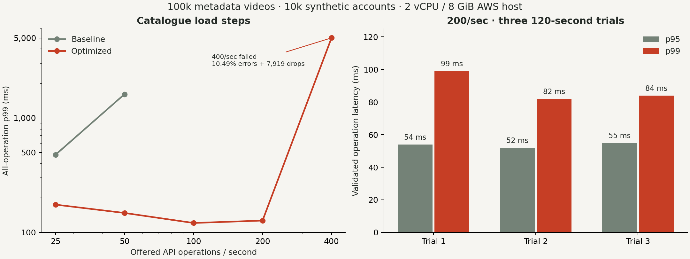
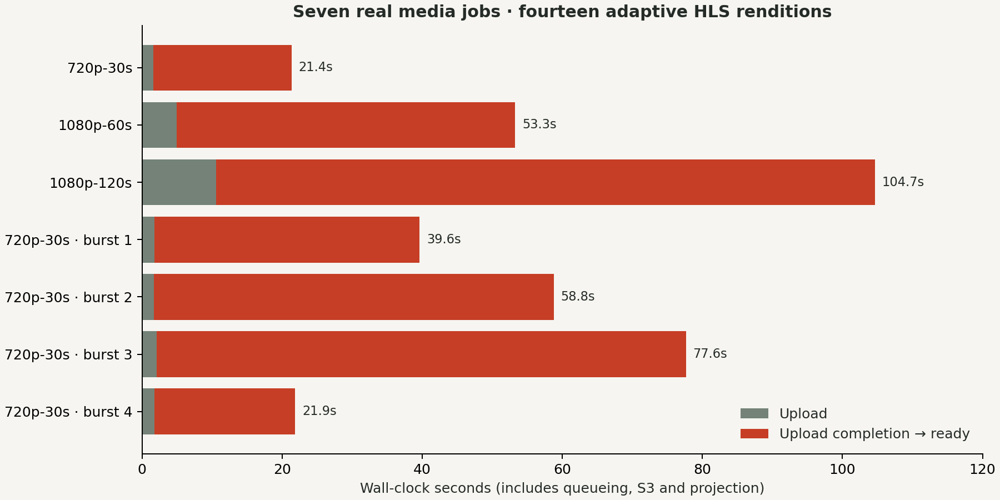

# PeerShare benchmark report — 15 October 2026

The completed catalogue campaign sustained **200 offered operations/second** against **100,000 video records and 10,000 synthetic accounts**, across **three 120-second trials**. The trials completed **72,002 validated operations**, with **zero failed requests, zero dropped iterations, p95 at most 55 ms and p99 at most 99 ms**. These results describe the workload and deployment below; they are not concurrent-viewer capacity or customer adoption.

The media pipeline also processed actual moving 720p/1080p sources into verified adaptive HLS. A 120-second 1080p source became ready **94.069 seconds after upload completion**, including queueing, encoding, private S3 output and catalogue projection.

## Deployment and workload

| Item                        | Measured configuration                                                                                                                                                            |
| --------------------------- | --------------------------------------------------------------------------------------------------------------------------------------------------------------------------------- |
| AWS host                    | Mumbai `m7i-flex.large`, 2 vCPU, 8 GiB RAM; existing single application host                                                                                                      |
| Catalogue baseline          | `891c8a01bbe34928d5112b3f35cb1ec920bdc69e`                                                                                                                                        |
| Catalogue optimized release | `0734601d6e1acaecc5527e9a35df3e63367acfb9`                                                                                                                                        |
| Load generator              | External Linux i7 workstation, 24 logical CPUs; k6 1.8.2                                                                                                                          |
| Request path                | One TLS-verified SSH tunnel to the isolated loopback gateway; network/tunnel costs are included                                                                                   |
| Isolated application        | Two API processes, each capped at 1 CPU and 384 MiB; Envoy capped at 1 CPU and 256 MiB                                                                                            |
| Shared services             | PostgreSQL on the existing host; separate benchmark database/role and Redis index 2                                                                                               |
| Data                        | 10,000 synthetic users, 1,000 active channels, 100,000 metadata-only videos, 100,000 subscriptions, 10,000 playlists, 100,000 playlist entries, 20,000 synthetic playback records |
| API mix                     | 30% feed/cursor, 20% search including absent terms, 15% channel feed, 15% video detail, 10% following, 5% playlist, 5% analytics                                                  |
| Validation                  | Status and JSON semantics checked; failures and dropped iterations reported separately                                                                                            |
| Isolation                   | Benchmark API rejects writes; no Kafka/media-worker/S3 credentials; synthetic records do not populate the public platform                                                         |

The normal product services and private benchmark replicas shared the same host. This is not a dedicated-host capacity measurement. Source hashes, per-phase counters, generator resource records and two-second host/container samples accompany the raw results.

The [protocol](protocol.md) declared rates, durations, stopping rules, thresholds and traffic budgets before the main campaign. A step passes when request failures are below 1%, p95 below 250 ms, p99 below 500 ms, no iterations are dropped, and at least 98% of offered work completes. The highest candidate is repeated three times. A stress spike and recovery phase follow it.

## Catalogue results

| Trial              | Offered operations/sec | Completed |  p95 ms |  p99 ms | Failures | Dropped iterations | Result |
| ------------------ | ---------------------: | --------: | ------: | ------: | -------: | -----------------: | ------ |
| Baseline step      |                     25 |     1,501 |  237.00 |  477.00 |    0.00% |                  0 | Pass   |
| Baseline step      |                     50 |     3,001 |  337.00 | 1612.00 |    0.00% |                  0 | Fail   |
| Baseline steady 1  |                     25 |     3,001 |  235.00 |  556.00 |    0.00% |                  0 | Fail   |
| Baseline steady 2  |                     25 |     3,000 |  238.00 |  637.02 |    0.00% |                  0 | Fail   |
| Baseline steady 3  |                     25 |     3,001 |  240.00 |  579.00 |    0.00% |                  0 | Fail   |
| Optimized step     |                     25 |     1,501 |   82.00 |  175.00 |    0.00% |                  0 | Pass   |
| Optimized step     |                     50 |     3,001 |   73.00 |  148.00 |    0.00% |                  0 | Pass   |
| Optimized step     |                    100 |     6,001 |   55.00 |  121.00 |    0.00% |                  0 | Pass   |
| Optimized step     |                    200 |    12,001 |   56.00 |  127.00 |    0.00% |                  0 | Pass   |
| Optimized step     |                    400 |    16,081 | 5001.00 | 5002.00 |   10.49% |              7,919 | Fail   |
| Optimized steady 1 |                    200 |    24,001 |   54.00 |   99.00 |    0.00% |                  0 | Pass   |
| Optimized steady 2 |                    200 |    24,001 |   52.00 |   82.00 |    0.00% |                  0 | Pass   |
| Optimized steady 3 |                    200 |    24,000 |   55.00 |   84.00 |    0.00% |                  0 | Pass   |
| Optimized recovery |                     25 |     1,501 |   83.00 |  180.00 |    0.00% |                  0 | Pass   |

Latency columns include all completed operations, including failed/time-out operations, and are rounded; raw percentiles retain their precision. The protocol applies latency thresholds to successful validated operations and separately limits failures. Scenario arrival rates exclude setup/drain; whole-process observed throughput of the 200/sec steady runs was approximately 198.96–198.97 operations/sec. The baseline never established a passing three-trial steady rate.

The 400/sec result is a failed load level on this complete path. It does not prove that 400/sec is the server's maximum: generator scheduling, the SSH tunnel and network are part of the experiment. The recorded server utilization does not establish full CPU saturation at that level.

### Stress and recovery

The optimized 800/sec, 30-second spike completed 23,784 operations: 13,762 successful responses and **10,022 server 5xx responses**, with **217 dropped iterations**. There were no transport failures or 429 responses in that spike. All-operation latency reached p95 753 ms and p99 1,095.17 ms; successful-request latency was p95 877 ms and p99 1,229 ms. Fast error responses make latency alone misleading. The approximately 42.14% request failure rate is a failed stress phase, not a successful capacity claim.

The following 25/sec recovery phase passed with no errors or drops. Raw records retain the failed phases as well as the successful ones. The baseline spike at 100/sec failed with 4.324% request failures and 41 drops; its later recovery still failed the p99 threshold.

### What changed in the Go/SQL implementation

The search query previously combined optional predicates in ways that could make an absent term scan much of the catalogue. The optimized query uses parameterized shapes for actual filters, separates full-text matches from creator matches, and bounds each matching creator's ordered page before merging results. Cursor, following, visibility and fixture filters remain inside both branches. A final order and `limit + 1` determine the next cursor.

Creator analytics also gained an index for metadata invalidation checks, including drafts and unpublished videos. The published channel index includes source kind so the corresponding filter can avoid heap visits. These indexes follow real query predicates and ordering; they are not blanket indexes on every column.

Representative plans expose the tradeoff: the revised absent-term path became much cheaper, while a common-term search could be slower than its earlier best case. The mixed, repeated workload is therefore stronger evidence than quoting one favorable query plan. At the matched one-minute 50/sec step, p99 changed from 1,612 to 148 ms; this is one measured pair, not a universal percentage improvement.

### Redis analytics cache

| Condition              | Operations | p95 ms | p99 ms | Cache behavior                        |
| ---------------------- | ---------: | -----: | -----: | ------------------------------------- |
| Cached analytics       |        601 |    192 |    217 | 597 hits, 4 misses, 0 errors/bypasses |
| Forced fresh analytics |        600 | 209.05 | 237.12 | 600 bypasses, 0 cache hits/errors     |

These tests ran at 10 offered operations/sec for 60 seconds per condition. The measured hot-cache hit ratio was approximately 99.3%. End-to-end latency improved modestly in this campaign; the records do not support a dramatic Redis speedup claim. Redis also enforces rate limits, but cache hits do not replace PostgreSQL ownership checks or source-of-truth aggregates.

## Actual media processing

Seven jobs used generated moving H.264 sources: one 720p/30s, one 1080p/60s, one 1080p/120s, followed by four 720p/30s uploads submitted as a burst across separate approved editorial owners. Total input was **161,680,558 bytes and 330 seconds of source work**. These are real sources, not metadata rows; the four burst jobs reuse one source.

| Source/condition   | Upload time ms | Upload completion → ready ms | Total ms |
| ------------------ | -------------: | ---------------------------: | -------: |
| 720p, 30 seconds   |          1,619 |                       19,749 |   21,368 |
| 1080p, 60 seconds  |          4,945 |                       48,325 |   53,270 |
| 1080p, 120 seconds |         10,603 |                       94,069 |  104,672 |
| Burst job 1        |        See raw |                       20,109 |  See raw |
| Burst job 2        |        See raw |                       37,835 |  See raw |
| Burst job 3        |        See raw |                       57,143 |  See raw |
| Burst job 4        |        See raw |                       75,518 |  See raw |

The four-upload burst completed **77.887 seconds** after the first submission started. The worker handled the queue serially; this does not demonstrate four parallel encoders. Recorded peak worker usage was about 180.4% of one CPU core and 298.6 MiB cgroup memory, with no OOM events.

Independent output inspection checked all seven jobs, fourteen renditions, manifests and first/last segment hashes: **28 segment SHA-256 checks passed**. “Ready” timing includes projection/polling and S3 work, so it is not a pure FFmpeg frames-per-second benchmark. Pipeline measurements describe the earlier `8bbe704` public application release. The raw archive includes the byte-identical [measured script](../evidence/phase-6/benchmark/raw/pipeline-v1/measured-source.mjs), verified against its recorded SHA-256; a later reporting-only correction removed two nonexistent preview fields, and actual output verification was performed separately.

## Video delivery

The first anonymous HLS trial at 25 simulated playback clients exposed a real admission bottleneck: 107 of 200 segment requests passed full size/hash checks; 93 returned 503, a 46.5% failure rate. Four concurrent S3 reads per API immediately rejected excess requests. Those failed results are retained.

Release `4e689dd` adds bounded waiting behind the same four active reads per API, without increasing simultaneous media-buffer allocation. A matched repeat and fresh-browser HTTP/peer comparison are still being completed. They will be reported separately from the catalogue campaign and will not be inferred from older one-video examples.

A simulated segment client is not a decoding browser. Peer tests must compare equivalent complete playback, fresh browser caches and consent setup, report real decoded playback and rejected segments, and preserve each repeated run. Server payload reduction is not measured AWS billing savings.

## Resume wording supported now

- Built a Go/Next.js video platform with resumable publishing, adaptive HLS, private S3, Google OIDC, Kafka/gRPC media services and opt-in verified WebRTC delivery.
- Load-tested an isolated 100k-video catalogue at 200 offered operations/sec across three two-minute trials on a 2-vCPU/8-GiB AWS host: 72,002 validated operations, p95 ≤55 ms, p99 ≤99 ms, zero request failures or dropped iterations.
- Processed a 120-second 1080p source into 480p/720p HLS in 94.1 seconds after upload completion; verified fourteen renditions across seven real pipeline jobs.

Do not describe the 10,000 synthetic accounts as active customers, the 100,000 rows as encoded videos, the 200 API operations/sec as video viewers, or the failed stress spike as successful throughput. Multi-network playback was user-reported; no device counters were supplied. No billed cost-saving percentage is established.

## Reproduce and inspect

Read the [protocol](protocol.md) and [measurement guide](../learning/phase-6/04-benchmarking-a-video-system.md). The raw archive is in [benchmark evidence](../evidence/phase-6/benchmark/), with a SHA-256 manifest. Public/editorial content, private media fixtures and the isolated synthetic database have separate purposes and cleanup paths. Extra catalogue benchmark processes were stopped after the campaign; no additional paid host was created.
