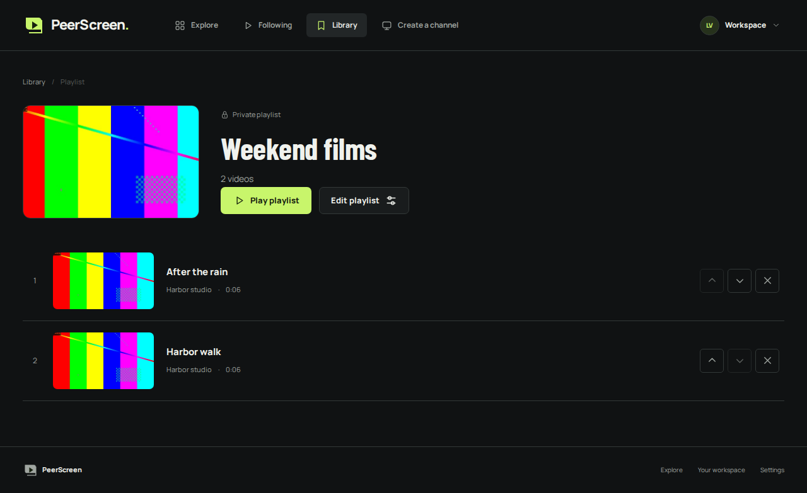
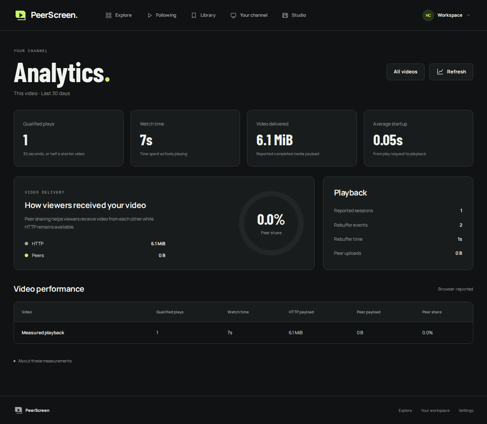

# Phase 4 evidence

The connected product is implemented and verified locally. Following, search, playlists, playback queues and creator Analytics run in the normal app. The five supplied review findings are fixed. No cross-network result has yet been recorded; the user confirmed devices on two networks are available for that exercise.

## Connected product checkpoint, 14 October 2026

| Product capability   | Observed result                                                                                                                                                        |
| -------------------- | ---------------------------------------------------------------------------------------------------------------------------------------------------------------------- |
| Follow and Following | A separate viewer follows a real creator; both published uploads appear, and unfollow removes them from the feed                                                       |
| Search               | Finds a video absent from the loaded page through real server pagination; Following/channel search remains editable after zero results                                 |
| Playlist             | Save two processed videos, reorder, reload, deny guest access while private, switch public and open as a guest                                                         |
| Playlist playback    | Play playlist starts its first visible video and the real `ended` event advances to the next video                                                                     |
| Current visibility   | Unpublished video disappears for guests; owner sees an unavailable slot and removes it                                                                                 |
| Analytics            | Actual uploaded-video playback produces one logical session across sharing changes, a qualified play and positive HTTP payload; guests cannot read the owner dashboard |
| Editor identity      | Delay A's real thumbnail-save response, open/edit B, release A's response; B's thumbnail/revision stay usable and its title saves                                      |
| Sharing control      | Deliberately fail player integrity initialization after opt-in; opt-out remains enabled and survives retry/reload                                                      |
| Responsive screens   | Actual desktop/mobile Library, playlist and Analytics screenshots; channel actions wrap on small screens                                                               |

The [backend record](product-backend.json) contains **53 top-level cases, 78 including subcases**, with the race detector and real dependencies. The cancellation regression uses real encoded/accepted output with controlled catalogue lag, and also repairs an already-seen snapshot hidden by local retry intent. It is not a new crash experiment. Sixteen concurrent slow request bodies exercise the chunk handler against its real sixteen-connection pool: twelve are admitted, four return 429 promptly, and another database query succeeds. This checks admission/connection behavior directly, rather than claiming a TCP load benchmark.

The [first production browser pass](product-browser-initial.json) passed 23 of 25 cases. It found a real small-screen overflow introduced by the new follower control and a test selector that ignored the Published button's count. After correcting both, the [focused follow-up](product-browser-followup.json) passed all five affected product cases. These runs cover all 25 distinct workflows; they are not represented as one uninterrupted all-green run. The [final Analytics-only layout capture](analytics-layout.json) passed after the mobile heading adjustment. Formatting/types, all eight JavaScript cases, contract/protobuf checks, Go vet and production builds passed before the checkpoint.

### Uploaded peer media

The [raw observation](uploaded-peer.json) used a real uploaded 32-second 720p generated source, three fresh Chromium contexts per mode, HTTP cache disabled, the same 480p choice and seed warmup, and approximately eight-second observation windows. STUN remained disabled. All measured received segments verified and no segment was rejected. The peer run received **5,640,000 peer payload bytes** across viewers and reported **5,640,000 uploaded peer payload bytes**. After a seed left and sharing was disabled, a receiver decoded a 720p seek through HTTP.

The test-only gateway counted response-body bytes: **11,010,596 HTTP-only**, **2,820,000 in the measured peer run**, plus **9,440,984 during separate consent setup**. Including consent setup, the peer exercise used **1,250,388 more HTTP bytes**. This is one local observation with different buffer/playhead progress, not a statistically controlled bandwidth benchmark or a claim of delivery-cost savings. The gateway counter is available only in the disposable test runtime; the normal app returns 404 for it. Existing real data-channel corruption and HTTP-fallback browser checks also passed.

### Running app and learning material

The normal container app was rebuilt/upgraded with persistent volumes. A private PostgreSQL snapshot was saved with mode 600. [Preservation observations](preserved-runtime.json) show unchanged original video segment, custom thumbnail and channel-banner hashes, the same rendition, and Google still enabled. This is not a full backup/restore exercise or a new live Google login. New routes return 200, anonymous creator analytics returns 401, and the test-only delivery endpoint returns 404.

Screenshots use generated test creators/videos, not the user's account. Read the [feature learning guide](../../learning/phase-4/README.md) for models, APIs, Go/React concepts and hands-on exercises. The physical two-device/network result and a private access route are still pending; see [the device procedure](../../learning/phase-4/04-device-exercise.md).





The earlier foundation records below are historical and retain their original fingerprints. New product fingerprints bind this checkpoint's source and observations separately.

## Foundation checkpoint, 14 October 2026

- Formatting, generated OpenAPI types, TypeScript and all eight JavaScript cases passed.
- Full Go suite passed with the race detector: **46 top-level cases, 70 including named subcases**, zero failures or skipped tests. Applicable integration cases use real isolated PostgreSQL, Redis, Kafka, gRPC and FFmpeg. [Named results](library-backend.json).
- Actual Docker images processed and published a generated 720p MP4, served 480p/720p segments, followed the channel, returned the Following/search result, saved the video to a private playlist, and denied anonymous playlist access. Complete profiled teardown and an empty disposable project were checked. [Container observations](library-containers.json).
- The normal `peerscreen` project and its user data were not used for destructive verification. Migration `0007_viewer_library.sql` is additive; existing applied migrations are unchanged.

| New scenario                                                | Observed result                                                                                                                                                                                                                                                                                                                                             |
| ----------------------------------------------------------- | ----------------------------------------------------------------------------------------------------------------------------------------------------------------------------------------------------------------------------------------------------------------------------------------------------------------------------------------------------------- |
| `TestIntegrationSubscriptionsReplayFollowingAndSearch`      | Repeated/eight concurrent follows preserve one pair; anonymous mutation/Following denied; search title/tag edits and cursor pagination work; unpublished metadata excluded; repeated unfollow removes the feed relationship; origin/length bounds enforced                                                                                                  |
| `TestIntegrationPlaylistsOwnershipVisibilityOrderAndReplay` | Stable creation key returns one ID; changed input conflicts; private reads/mutations deny other users; duplicate save is unchanged; invalid reorder rolls back; valid reorder swaps positions; stale revision conflicts; public reads omit unpublished IDs/metadata; owner can remove unavailable items; deleted creation key cannot resurrect the playlist |
| `TestIntegrationConcurrentPlaylistCreationAndRevision`      | Eight equivalent creates return one playlist; two edits based on one revision produce one commit and one explicit revision conflict                                                                                                                                                                                                                         |

These library cases use controlled published catalogue metadata. Their scope is relational/API behavior, not video encoding. The container check separately exercises the real source-upload and packaged media pipeline.

## Findings and corrected failure runs

The initial broad run passed the new library cases but exposed two existing regression failures. Equivalent media submissions could contend on the secondary `(video_id,generation_id)` unique index even though `ON CONFLICT(id)` handled the primary key. Per-job transaction locking before insertion now serializes the equivalent submissions; the complete concurrent RPC regression passed.

The lifecycle poison-record check repeatedly failed because stale `peerscreen-test` app containers survived dependency teardown. Kafka group logs showed a second catalogue consumer. Compose services behind the `app` profile were not included in the default down operation. The helper now includes that profile for down/stop, and the image runner asserts that no disposable app containers remain. After removing only the stale test project, the original fifteen-second poison-record check and the full connected media suite passed. Extending the timeout did not resolve the cause and was reverted.

Bounded Kafka protocol-code diagnostics and test consumer logs improve future failure analysis without recording credentials or message payloads. The corrected suite, not the earlier failed runs, is the source of the passing case record.

## Reproduce and interpret

```sh
npm run check
npm run contracts:check
npm run test:integration
npm run test:containers
```

Run dependency suites sequentially; they share the disposable project. This host requires `PEERSCREEN_BUILD_NETWORK=host` for image downloads. The runtime network remains private. Private credentials, cookies, tokens and actual Google configuration are excluded from committed evidence.

[Foundation source fingerprints](library-fingerprints.json) bind the backend/contracts/runtime scripts and records to this checkpoint. Git history provides its exact commit. Phase 3's closing [CI run succeeded](https://github.com/darshpatel1052/Peer-Screen/actions/runs/38533968360); that historical success is separate from this checkpoint's subsequent CI.
