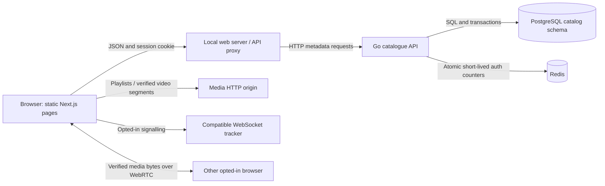

# Components and a request's journey

Phase 1 connects identity and persisted metadata to the existing verified player. The backend foundation is implemented first, then the browser journeys are integrated and verified. The evidence report identifies which checkpoint each observation belongs to.

## Metadata and media take different paths

The API sends small JSON documents: identity, title, channel, duration, accepted version and playback URLs. Video bytes travel through the media origin or WebRTC. Keeping those paths separate avoids proxying a large video through a metadata handler and preserves the CDN/storage boundary planned in the full architecture.

The catalogue database is authoritative for visibility and ownership. A player cache is not a catalogue, and seeing bytes in storage does not make a video published. Redis and a tracker cannot decide whether a channel belongs to a user.

## Static frontend with live data

Next.js emits fixed HTML/CSS/JS routes during the production build. `/account/`, `/channel/?id=…` and `/watch/?v=…` remain reloadable routes. Browser components then fetch current API data. “Static export” describes how frontend files are hosted; it does not mean the product data must be frozen at build time.

Authentication, channel metadata and catalogue state are not embedded in a public build. Server actions/runtime server routes would require a different hosting model, so we keep those responsibilities in Go. The generated API types are compile-time support for the client and do not add a Next.js server.

The local Node server hosts the export and forwards `/api/v1/…` to the private Go listener. This gives the browser one origin for its session cookie and metadata calls. It is a local development/demo proxy, not the finished Envoy gateway or TLS deployment. Future gateway work will add the routing/replica/connection policies described in the brief.

## Go catalogue API

The transport package translates HTTP into application operations. Authentication resolves the current user; SQL methods enforce persisted ownership and state. `config` checks deployment settings, `auth` supplies cryptographic helpers, `ratelimit` handles the disposable shared budget, and `store` owns PostgreSQL access.

We use a small number of cohesive packages instead of creating a service for each table. A process boundary is justified by ownership, execution requirements or deployment needs; a directory alone is not a distributed service. There is one catalogue API in Phase 1. The coordinator/worker/gRPC/Kafka boundaries remain later milestones, with no simulated successful job endpoints.

The process opens one `pgxpool` with up to sixteen connections. A connection pool reuses expensive network/database sessions, limits how many queries the process can issue concurrently, and releases a connection after the operation. This is a per-process limit; two API replicas would have two pools and their total must be planned against the database's connection budget.

## PostgreSQL owns durable state

The instance contains a `catalog` schema owned by the catalogue role. The administrative bootstrap creates the role/schema; migrations create the tables and indexes. API queries explicitly name `catalog` tables rather than depending on a permissive global namespace.

Users, sessions, channels and videos survive API restarts because they are in PostgreSQL. The Docker application volume persists database files across normal container restarts. This is local durability, not a backup strategy or machine-level high availability. A lost/corrupted volume still requires a separately tested backup/restore plan later.

The application role also runs its owned-schema migrations in this initial setup. It cannot create tables in `public`; it can perform DDL in its own schema. A separate, narrower runtime-only DML role is a future deployment-hardening decision, not a current capability claim.

## Redis has a narrower responsibility

Redis stores expiring authentication attempt counters shared by clients/API processes. Lua makes increment and initial expiry atomic. Redis does not hold the only copy of a user, channel or session. Session revocation is checked in PostgreSQL on each protected request.

The local Redis memory ceiling is 64 MiB with noeviction. Evicting an active rate-limit counter could silently replenish a budget; returning a controlled error is preferable for authentication admission. The configured counters disappear on a Redis restart. Losing them resets a short window, while durable identity remains intact.

Readiness requires Redis and PostgreSQL to respond. A readiness failure does not terminate the process: liveness remains a separate signal. Public reads can still use PostgreSQL when Redis is unavailable; expensive authentication admission fails closed. The later gateway must decide how that readiness/degradation policy interacts with routing.

## Existing player and tracker

The watch response includes immutable accepted generation/attempt identifiers and trusted media URLs. The player retrieves the integrity descriptor, then verifies exact segment bytes and lengths. Opt-in initializes the compatible peer loader; opt-out destroys it and returns to verified HTTP.

The tracker exchanges discovery/signalling information. The video is not relayed through it. Actual peer media bytes move over RTCDataChannel connections. We retain the Phase 0 no-external-STUN loopback proof; cross-network configuration remains unverified deployment work.

The fixture importer derives stable accepted version IDs from the generated media version and stores genuine processed fixture metadata. Those deterministic IDs are names, not a security secret. File integrity still uses trusted SHA-256 descriptors and actual byte verification.

## OpenAPI and generated types

OpenAPI gives reviewers and learners an explicit list of operations, inputs, outputs and errors. The generator turns those schemas into TypeScript shapes. A check regenerates and compares them, so a schema change cannot leave stale checked-in client types unnoticed.

The frontend fetch layer still handles real network concerns: cookies, JSON, timeout/cancellation, 204 responses and structured errors. A generated `Channel` type does not authenticate a request or prove a response arrived. Those concerns stay visible instead of being confused with static typing.

## Docker Compose and local lifecycle

The dependency file pins multi-architecture PostgreSQL/Redis image digests, binds host ports only on loopback, declares health checks, and bounds resources. PostgreSQL's volume is durable; Redis persistence is disabled for the disposable counters. `depends_on`/readiness and actual service checks should gate startup, not a guess such as “sleep for five seconds.”

The setup creates random development credentials once in `.local/local.env`, with private file permissions, outside Git. Reusing the database volume also requires reusing those credentials. Regenerating the file alone does not magically change an already initialized database password.

The normal project name is `peerscreen`. Integration tests use `peerscreen-test`, different host ports and a separate volume. Only that explicitly disposable test project's volume is removed by its runner. Stopping normal development preserves application data.

The Node wrappers coordinate local commands, choose the pinned Go toolchain, apply migrations/import the fixture, and start actual services. They do not implement product persistence or fake backend results. Reproducibility also needs lockfiles, clear prerequisites and tested startup/shutdown commands.

## Follow a channel-creation request

1. The signed-in browser form submits a handle/title/description using the shared JSON client.
2. The local proxy forwards the request and cookie, preserving Origin and removing spoofable forwarding/identity headers.
3. The Go wrapper assigns a request ID/deadline and checks the mutation's Origin.
4. Authentication middleware hashes the opaque cookie and reads a valid session/user from PostgreSQL.
5. The handler validates channel fields and calls `CreateChannel` with the authenticated user's ID.
6. PostgreSQL enforces foreign-key and uniqueness rules, including a racing second create.
7. The API returns the created channel and Location; the browser reloads its current account to display the owned channel.
8. A later page reload fetches the same persisted identity/channel rather than reconstructing it from React state.

The API is the authorization boundary, PostgreSQL is the durable invariant boundary, and React state is the display/cache boundary. All three are useful, but none should be mistaken for the others.

## Limits to keep in mind

This is one host, one database, one Redis and one API by default. Pinned images and multiple containers do not imply independent failure domains. The local proxy is not a completed production gateway; session tokens are not an OIDC system; a seed command is not an upload pipeline; a passing test is not a throughput benchmark. The following phases add those specific capabilities with their own evidence.

Primary references: [Next.js static exports](https://nextjs.org/docs/app/guides/static-exports), [pgxpool](https://pkg.go.dev/github.com/jackc/pgx/v5/pgxpool), [Redis Go client](https://redis.io/docs/latest/develop/clients/go/), [Compose services](https://docs.docker.com/reference/compose-file/services/).
