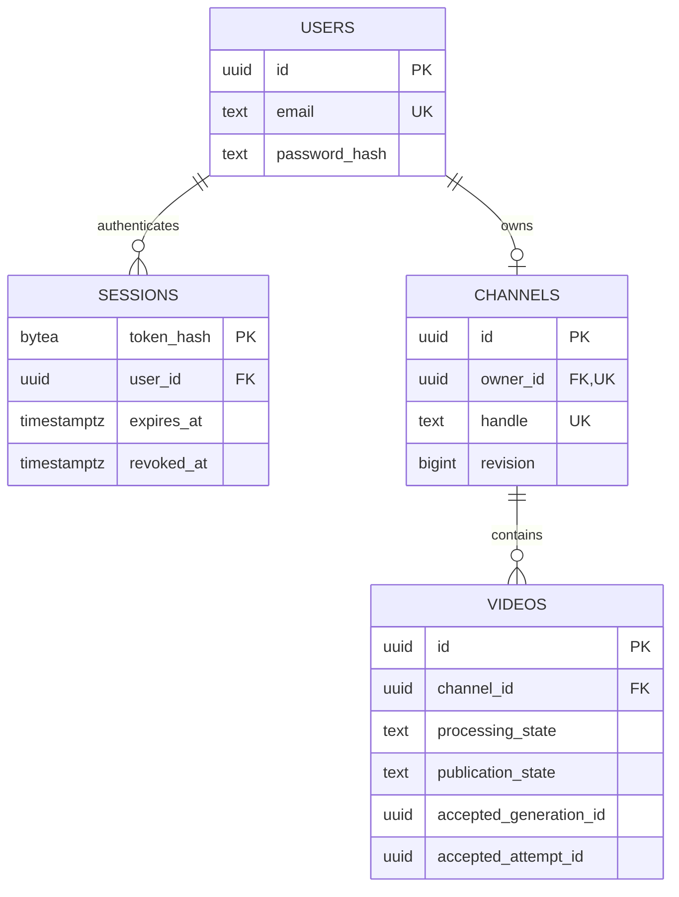

# Data modelling: why these tables and constraints exist

## Start with facts and relationships

An entity is something whose identity and lifecycle matter. A user exists independently of a browser session. A session can expire without deleting the user. A channel has an owner and metadata. A video belongs to a channel and has a processing/publication lifecycle. Putting these into separate tables lets those lifecycles change independently.



Read `users → channels → videos` as an ownership path. We deliberately avoid another `videos.owner_id`: a copied owner could disagree with `channels.owner_id`. Authorization derives the canonical owner through the channel. If a future feature permits channel transfers or multiple owners, we must design that change explicitly.

## Table-by-table decisions

### Users

`id` is a UUID primary key. It is stable if a display name or email changes and can be generated before a database write. UUIDs are identifiers, not permissions or secret access capabilities. Publicly knowing Alice's channel ID does not allow Bob to edit it.

`email` is lowercased and trimmed by the API. The database additionally checks that it is lowercase and unique. The same address with different case must not create separate login identities. This is a deliberate product policy; Phase 1 does not implement email delivery or verify ownership of the address.

`display_name` is bounded independently of email. `password_hash` contains an encoded Argon2id hash, including parameters and salt. A password's original text does not belong in the database. `role` has a closed set of values; registration always inserts a member and rejects an incoming `role` field. The fixture identity is a system account excluded from ordinary login.

### Sessions

The browser has the original random token; the table has its SHA-256 digest as a 32-byte `bytea` primary key. `bytea` stores binary data without pretending it is text. Session lookup compares the digest, then checks expiry and revocation in the database.

`user_id` is a foreign key. A session cannot refer to an absent user. `ON DELETE CASCADE` is appropriate for a session because it has no independent value after its user is removed. This does not mean the application currently exposes account deletion.

`timestamptz` represents an instant. Database connections and structured service logs use UTC. The driver's decoded Go times can serialize with the host's explicit offset: the local evidence includes `+05:30`, which describes the same instant rather than changing database time. Compare parsed instants, not their formatted text; display-time formatting can happen in the browser. Session validity uses PostgreSQL's time through `expires_at > now()`, so an API process's local clock does not decide that query. The cookie also has a client expiry, but the database check is authoritative.

Expiry/revocation are different facts: expiry is the normal lifetime boundary; revocation is an explicit logout or session-cap decision. Login removes that user's already expired/revoked records and retains the current session plus at most nineteen other active sessions. There is no global background session sweeper yet; unused expired rows can remain until later cleanup work.

### Channels

`owner_id` references `users.id` and is unique. The uniqueness enforces the initial one-channel-per-user policy. The API can check this for a readable error, but a database constraint is still needed: two concurrent requests can both see no channel before either inserts one.

`handle` is a unique, bounded lowercase slug. `title` and `description` are presentation metadata and do not determine ownership. The public response includes the owner's display name but excludes their email and internal owner ID.

`revision` starts at 1. An edit includes the revision the client read. The transaction locks the row, verifies the stored owner and revision, writes the new metadata, and increments the revision. This prevents a lost update: an older form cannot silently overwrite a newer edit.

The foreign key from channel to user does not cascade deletes. Removing an account with content requires a content/deletion policy; accidentally cascading through a metadata graph would not also clean up storage/CDN bytes correctly.

### Videos

The database stores title, description, tags, duration, channel identity and media object keys. It does not store the video bytes. A key such as `fixture/master.m3u8` names an object under a trusted media base URL; the frontend receives a resolved playback URL.

`processing_state` and `publication_state` answer different questions. “Ready” means the processing output was accepted. “Published” means the creator chose public visibility. A ready draft can remain private. A CHECK constraint requires the necessary accepted-version metadata before the row can claim to be published.

That CHECK establishes metadata consistency; it cannot prove a segment exists in storage or was encoded correctly. Storage/output acceptance is part of the later worker/coordinator protocol. The current fixture has real generated media and is imported deliberately by a seed command.

Accepted generation/attempt IDs name a particular processed result. They are included in the player's peer namespace so different accepted outputs cannot share a pool accidentally. `deleted_at` is a tombstone: public queries require it to be null even if a delayed processing event eventually appears. Event fencing itself comes in later phases.

Tags are a bounded PostgreSQL array for this small catalogue. An array is a useful initial representation for a short list read with its video. A separate tags/video_tags model would become useful for richer tag management and query workloads. We have not created unused job, playlist or subscription tables just to match an architecture diagram.

## Constraints protect concurrent reality

- **PRIMARY KEY**: a row has one unique, non-null identity.
- **FOREIGN KEY**: a child references an existing parent.
- **UNIQUE**: racing requests cannot persist duplicate canonical emails, handles or channel owners.
- **NOT NULL**: required information cannot be omitted.
- **CHECK**: allowed states, bounds and cross-column rules are enforced.

SQL has three-valued logic: true, false and unknown (`NULL`). A CHECK fails on false, but unknown can pass. That is why the publication CHECK explicitly includes `qualities IS NOT NULL` before testing `cardinality(qualities) > 0`. Comparing an absent value alone would not reliably enforce its presence.

## Transactions and locks

Registration inserts a user and an initial session in one transaction. If the session insert fails, rolling back removes the user insert too. We test this by deliberately supplying an invalid session digest through the internal store, causing PostgreSQL's constraint to reject the second write, and verifying no partial user remains.

Password hashing occurs before the transaction, because holding database resources during expensive CPU work increases lock time and contention. A deferred rollback is a safety net for every early return; a successful commit completes the transaction.

Channel editing uses `SELECT … FOR UPDATE`. The row lock serializes concurrent edits of that channel. The expected revision additionally protects a stale client whose edit arrives after another transaction has already finished. A lock and a revision solve related but different problems.

## Queries, parameters and indexes

We use SQL parameters such as `$1`, not string interpolation of user input. The driver sends the value separately from the SQL instruction, so a title containing punctuation remains data.

The public catalogue always applies `publication_state='published' AND deleted_at IS NULL`. The same predicate appears in a partial index. A partial index stores only rows relevant to that query, and its ordering matches the feed's `published_at DESC, id DESC` order. A channel-feed index starts with `channel_id` because that query filters by channel before applying the ordered cursor.

Indexes trade faster reads for extra storage and write maintenance. Their presence is not a performance result. We have not yet profiled large workloads or proved the planner uses them efficiently at scale; later measurements should use EXPLAIN and realistic data.

## Cursor pagination

The cursor encodes the last result's publication timestamp and UUID. The next query compares the tuple:

```sql
(v.published_at, v.id) < ($2, $3::uuid)
ORDER BY v.published_at DESC, v.id DESC
```

The UUID breaks timestamp ties, preventing two same-time videos from being skipped or repeated. We fetch `limit + 1` rows to decide whether another page exists, return only `limit`, and encode the last returned row as the next cursor. The maximum page size is 30.

Base64 encoding makes a cursor convenient to transmit; it is not encryption or authorization. Every page still applies the public-visibility predicate. This is keyset pagination, not a frozen database snapshot: new publications, deletions or future republishing can change the overall catalogue between requests.

## Migrations and schema ownership

The catalogue role owns only the `catalog` schema. A test verifies it cannot create a table in `public`. A separate administrative role initializes the database and service credential. The catalogue owner also runs its migrations in this local design; this is not a claim that its runtime role has DML-only permissions.

Each embedded migration has a filename/version and SHA-256 checksum recorded in `catalog.schema_migrations`. A transaction-level advisory lock serializes migration runners. Re-running an unchanged migration is safe; changing an already applied file is rejected. Add a new migration to evolve a schema.

This initial runner applies the available migrations in one transaction. It has no automatic destructive rollback command and is not yet an expand/contract deployment system. Docker's persistent application volume survives normal restarts; deleting a volume is a separate data-destruction action.

## Exercises

Use the disposable integration database: attempt an orphan channel insert; race two channel creates; edit with an old revision; query a draft through the public video endpoint; create two published metadata fixtures with equal timestamps and page through them. Predict the database constraint or HTTP status before running each case. The corresponding tests show the actual assertions.

Primary references: [PostgreSQL constraints](https://www.postgresql.org/docs/18/ddl-constraints.html), [transaction isolation](https://www.postgresql.org/docs/18/transaction-iso.html), [indexes](https://www.postgresql.org/docs/18/indexes.html), [pgx documentation](https://pkg.go.dev/github.com/jackc/pgx/v5).
