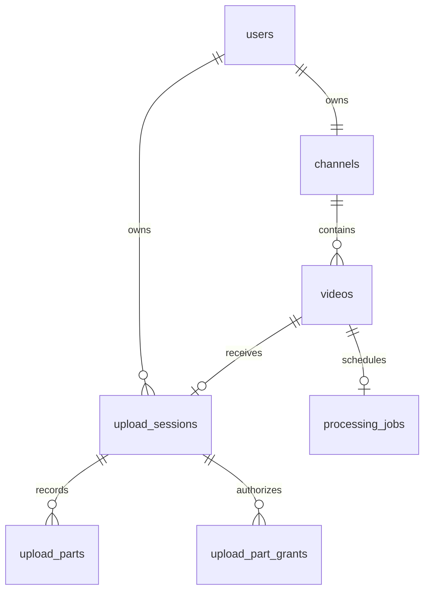

# 2. Modelling uploads, processing and visibility

The schema is extended with `0002_uploads.sql` and `0003_upload_recovery.sql`. The first file preserves your original Phase 2 migration byte for byte; the third adds recovery fields rather than changing an already-applied checksum. The migration runner embeds SQL, locks its ledger, checks each checksum and applies a new migration transactionally.

## Relationships

A user owns a channel; the video belongs to that channel. A session also records its canonical owner. Owner checks use the authenticated session and database relationships. They do not trust an `owner_id` payload or forwarded user header.

| Table/field                                         | Meaning and invariant                                                                                  |
| --------------------------------------------------- | ------------------------------------------------------------------------------------------------------ |
| `videos.source_key/source_bytes`                    | Server-selected private source identity and verified byte length                                       |
| `videos.processing_state`                           | Pending, processing, ready, failed or cancelled                                                        |
| `videos.publication_state`                          | Draft, published or unpublished, independent of processing                                             |
| `videos.accepted_generation_id/accepted_attempt_id` | The one output accepted for public/private playback                                                    |
| `videos.revision`                                   | Monotonic metadata revision for stale-edit detection                                                   |
| `videos.deleted_at`                                 | Tombstone: hide immediately, prevent late worker resurrection, retain a cleanup reference              |
| `upload_sessions.expected_bytes`                    | Declared size bounded to 250 MiB; completion must verify this against actual storage                   |
| `idempotency_key/request_fingerprint`               | One logical create per owner/key, plus a SHA-256 hash of normalized request details                    |
| `part_checksums`                                    | Expected ordered browser chunk hashes when supplied; the studio always supplies them                   |
| `source_sha256`                                     | Full assembled source hash, computed by Go rather than treating multipart metadata as a full-file hash |
| `reserved_bytes`                                    | Capacity held for pending source, assembly, derivatives and retry/staging allowance                    |
| `parts_cleaned/cleanup_done`                        | Durable cleanup markers; quota is not released before physical cleanup succeeds                        |
| `upload_parts`                                      | Unique upload/part number, exact length, SHA-256 and immutable storage key                             |
| `upload_part_grants`                                | One current hashed capability per upload/part, expires in at most ten minutes                          |
| `processing_jobs.id/generation_id`                  | Stable logical job and output generation across retries                                                |
| `attempt_id/worker_id/lease_expires_at`             | One current execution capability and its database-time expiry                                          |
| `attempt`                                           | Total number of claims; recovery/retry is bounded to three                                             |
| `stage/progress/error_code/output_bytes`            | Persisted user-visible progress, safe failure classification and measured output size                  |

SQL foreign keys prevent parts without an upload and jobs without a video. Primary/unique constraints prevent two recorded parts with the same number and two jobs for one video. Check constraints bound sizes, counters and allowed state strings. These are protections even if a future caller bypasses the HTTP validation.

## Why a transaction is necessary

Creating an upload inserts a private video and session and reserves space. These must all commit or all roll back. Completion records the source and creates the job together. Otherwise a process crash could leave an uploaded source with no durable job, or a job with no source.

`Begin` starts a PostgreSQL transaction. `defer tx.Rollback(ctx)` cleans up failure paths; after a successful `Commit`, the deferred rollback is harmless. Requests use `context.Context` to give database work a deadline. Filesystem renames and SQL commits remain separate operations; the reconciler handles that boundary.

## Locks solve different races

A count followed by an insert is unsafe without serialization. Two requests can both see zero active uploads and both insert. The global admission advisory lock makes the count, quota sum, idempotency lookup and reservation one serialized decision. The policy allows one active upload per creator and four globally. Retries also reacquire their derivative reservation under the same admission lock.

A part uses a nonblocking advisory lock for its upload/part number. Distinct parts can transfer together; two writers for one part get a retryable conflict instead of staging arbitrary duplicate bytes. They also hold a shared upload lock. Completion and cleanup take an exclusive lock on that upload. Cleanup therefore cannot delete a directory or release its reservation while a part/assembler is still writing. These are PostgreSQL session locks held on a dedicated pooled connection, and they must be explicitly unlocked before returning it to the pool. If unlocking fails, the code closes that connection.

Worker claims serialize the single global execution slot, select a queued row with `FOR UPDATE SKIP LOCKED`, and persist the worker/attempt/lease before returning. Row locks serialize completion against cancellation and deletion. Every progress/heartbeat/finish operation compares the current capability. This is fencing: the identity and valid lease matter, not just who finishes first.

## Capacity accounting

The 20 GiB ceiling is an application reservation budget. Initial upload reservation is twice the declared source size, plus three 220 MiB derivative allowances and 128 MiB staging allowance. Another 128 MiB platform allowance covers the fixed fixture/staging overhead. This is intentionally conservative while retries and abandoned files can coexist.

After completion, cleanup removes part files and lowers the source portion to one copy. After a terminal job has aged ten minutes and an orphan sweep succeeds, settlement uses the verified source size and measured accepted output size. A retry must reserve the larger processing budget again before it is queued. Abort/expiry/deletion keep capacity reserved until cleanup succeeds. Filesystem errors leave records eligible for another cleanup pass.

This is local accounting, not an OS disk quota or an S3 billing guarantee. Preserve the storage roots/volumes with PostgreSQL; a database-only backup does not contain video bytes.
