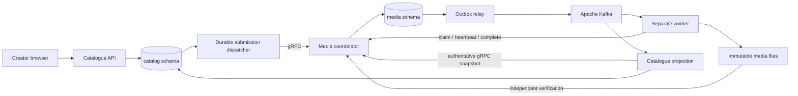

# Phase 3: Go media services, adaptive video and event streaming

Publishing a video now runs through three Go services: the catalogue accepts the upload, the coordinator assigns processing work, and the encoder creates adaptive HLS. Kafka carries notifications; typed gRPC connects the service APIs. This separation lets the product process videos independently of catalogue and viewer requests. Read [ADR 0004](../../adr/0004-media-services-and-durable-events.md) for the decisions and current verification boundaries.

Start with these chapters:

1. [Architecture and service ownership](01-architecture-and-ownership.md): what runs where, why the boundaries exist, and what "distributed" means in this local environment.
2. [Data model, transactions and outboxes](02-data-and-transactions.md): catalogue/media tables, stable identifiers, transaction boundaries, snapshots and deduplication.
3. [Go, protobuf and gRPC](03-go-and-grpc.md): generated contracts, interfaces, contexts, authentication, status codes and claim replay.
4. [Adaptive media and acceptance](05-adaptive-media.md): quality selection, actual FFmpeg output, descriptors, verification and storage cleanup.
5. [Kafka, worker leases and recovery](04-kafka-and-recovery.md): offsets, notifications, the reaper, epochs, retry and cancellation.
6. [Verification lab](06-verification-lab.md): reproducible checks, their expected observations, and the difference between integration and process-crash evidence.

The product learns that a video is ready through a persisted accepted result, not because a process exited or a message was delivered. Readiness still does not publish a video: the creator controls publication through the existing owner-authenticated HTTP API.

The phase is verified locally. Use [the detailed evidence report](../../evidence/milestone-3.md) to compare each architecture claim with an actual test, recorded crash, source fingerprint and known boundary. For a hands-on product check, upload your own 720p MP4 in Studio, preview it privately, publish it, then select 720p and 480p in the custom player. Existing lower-resolution uploads retain their accepted output; this change does not reprocess them.
