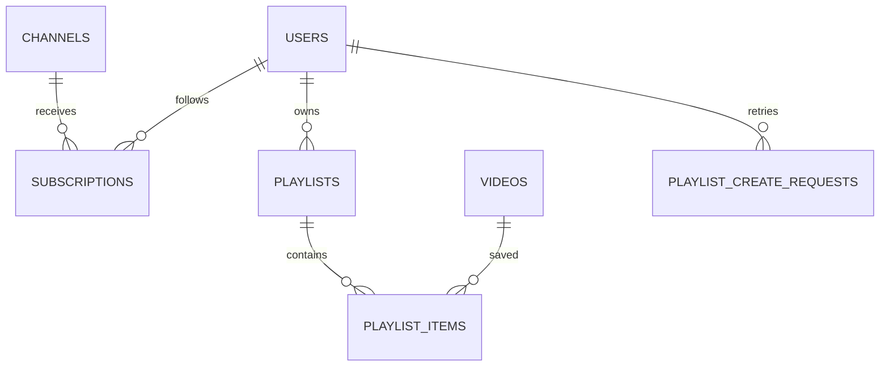

# Library relationships, transactions and search

This chapter explains the first Phase 4 backend slice. New tables are introduced by `services/api/internal/store/migrations/0007_viewer_library.sql`. Existing applied migrations remain unchanged. The Go store is in `internal/store/library.go`; HTTP handlers are in `internal/httpapi/library.go`. The versioned contract remains `contracts/openapi/catalog-v1.yaml`, with generated TypeScript in `packages/contracts/src/schema.ts`.

## A follow is a relationship, not another user or channel

`catalog.subscriptions` contains `user_id`, `channel_id` and `created_at`. Both IDs are foreign keys. The composite primary key `(user_id, channel_id)` means one viewer can follow many channels and one channel can have many followers, while any one pair exists only once.

`POST /channels/{id}/subscription` runs under the existing HttpOnly cookie session and exact-origin mutation rule. The API derives the follower ID from the authenticated session. A client cannot choose another follower through a request field. `DELETE` removes the pair; a repeated removal remains safe. An insert uses `ON CONFLICT DO NOTHING`, so an ambiguous response followed by a retry does not duplicate a relationship.

A per-account transaction advisory lock protects the count-and-insert decision for the limit of 500 followed channels. Counting first and inserting without a shared lock would allow two concurrent requests to both see the final free slot. The composite primary key solves duplicates; the lock solves capacity. They enforce different invariants.

`GET /channels/{id}/subscription` returns the public follower count and whether the current valid session follows the channel. Without a session, `following` is false. A database outage returns a service error rather than pretending that a signed-in viewer is anonymous. The complete own channel list is bounded to 500 records; the Following video feed still uses cursor pagination.

`GET /videos?feed=following` requires a session and adds an `EXISTS` condition against the subscription pair. It retains the existing publication/deletion visibility rule. Following a channel does not expose its drafts, previews or unpublished videos.

## Playlist identity and ordered items

`catalog.playlists` owns the title, owner, private/public visibility, revision and timestamps. `catalog.playlist_items` owns the relationship between one playlist and one video, including its position and added timestamp. This avoids storing a large list of IDs inside a single mutable text field.

The item primary key `(playlist_id, video_id)` prevents saving the same video twice in one playlist. Another unique constraint protects `(playlist_id, position)`, preventing two rows from occupying the same place. Positions are integers from zero to 199. Each account can have at most 50 playlists, each with at most 200 items.

Why defer position uniqueness until transaction commit? Imagine swapping positions zero and one. Updating the first row to one would temporarily collide with the second row if uniqueness were checked immediately. A deferred constraint allows the intermediate state inside a transaction but still rejects an invalid final order at commit. Other connections never receive that half-written order. [PostgreSQL constraint timing](https://www.postgresql.org/docs/18/sql-set-constraints.html).

The reorder handler requires a complete permutation of existing video IDs. It rejects duplicates, omissions and foreign IDs. The store takes a row lock on the parent playlist before validating and updating items. All item operations take that same lock, so an add cannot slip in between validation and reordering. The transaction also increments the playlist revision.

Removal closes position gaps within the same transaction. Read operations use a read-only repeatable-read transaction: playlist metadata, item IDs and public video metadata come from a consistent snapshot. The store uses bounded bulk queries instead of one video query per item.

## Revisions prevent silent overwrites

A revision represents the version of a mutable product record. Suppose two tabs open revision three. Tab A renames the playlist and commits revision four. Tab B submits a reorder with revision three. The API returns `409 revision_conflict`, allowing the UI to preserve the user's intention and reload the new state.

The row lock serializes overlapping transactions. The revision verifies that the user's edit was based on the current record. A lock alone would allow Tab B to wait and then overwrite A's change using stale form data. A revision alone without a locked decision can allow both operations to pass their check simultaneously.

This product revision is separate from a media processing epoch. Both protect concurrent changes, but their subjects differ: playlist revisions protect user edits, while media epochs protect which worker can accept an output attempt.

Owner checks are performed in the locked SQL query. Another account receives 404 for an owner mutation; private playlist reads also return 404. No client-supplied `is_owner` flag grants permission.

## Visibility is evaluated for each saved video

A public playlist is a shareable list of currently published videos. It is not a permission container for otherwise private media. If a creator unpublishes or deletes a saved video, public playlist reads omit it, including its ID/title/thumbnail. Visible positions are compacted for the response.

The playlist owner still receives an item with its saved `video_id` and `video: null`. This lets the owner remove a now-unavailable item without seeing private metadata belonging to its creator. The UI should label that row "Video unavailable". Removing it updates the stored order. If it is published again while still saved, it can become visible again; permanently removing the item ends that relationship.

The operator fixture visibility policy is retained. Normal product lists do not silently inject test films. Actual source encoding and peer playback are verified separately from these metadata-only database fixtures.

## Creation retries need a stable operation identity

`POST /playlists` requires a UUID `Idempotency-Key`. The API normalizes the title and visibility, then hashes that immutable creation input. `catalog.playlist_create_requests` stores the actor/key, hash and logical playlist ID in the same transaction as creation.

An equivalent retry returns the existing playlist, even if the original response was lost. Reusing the key with another title or visibility returns 409. A per-account advisory lock protects creation limits and concurrent key lookup. Eight simultaneous equivalent creates must return one ID.

Deleting a playlist sets its retained creation reference to null. An old retry then conflicts instead of resurrecting it. The first implementation bounds retained creation keys at 500 per account; this is a local capacity policy, not an unlimited production retention strategy. Later retention changes must define their idempotency window explicitly.

Other playlist operations carry the current revision. A lost mutation response is resolved by reloading the authoritative snapshot before retrying; reusing an old revision returns a conflict. Adding an already-saved video with the current revision leaves the row/revision unchanged. These semantics should be explained in the client instead of blindly retrying stale mutations.

## Search moves from loaded cards to PostgreSQL

Previously, the browser filtered only the first loaded videos. The new `q` parameter applies to the database query before cursor pagination. A result outside the loaded page can now be found directly.

The migration adds a `tsvector` search document. A trigger updates it whenever title, tags or description change; it also fills documents for existing videos. The configuration is explicitly `pg_catalog.simple`, keeping word normalization consistent between stored documents and query parsing rather than depending on the server's default language. Titles and tags receive weight A, descriptions B. Results currently remain chronological; those weights do not imply relevance ranking is already implemented. [PostgreSQL search documents and triggers](https://www.postgresql.org/docs/18/textsearch-features.html).

`websearch_to_tsquery` accepts forgiving word/phrase search syntax. A GIN index supports document matching for published, nondeleted videos. GIN is PostgreSQL's preferred full-text index type. [Text-search indexes](https://www.postgresql.org/docs/18/textsearch-indexes.html).

The API bounds search to 120 characters and rejects invalid text. SQL parameters keep a query from becoming executable SQL. Creator names also support literal case-insensitive matching. Full-text document search matches normalized words/phrases; it is not a claim of fuzzy spelling correction or arbitrary word-prefix matching.

Pagination keeps `(published_at, id)` in descending order. The UUID breaks timestamp ties, and a cursor selects strictly older tuples. The browser must reset its cursor when search text, channel or feed changes. It must cancel an older request so a slow response for the previous search cannot replace the latest results.

## HTTP and Go reading map

| Operation             | Endpoint under `/api/v1`                                                | Store decision                                            |
| --------------------- | ----------------------------------------------------------------------- | --------------------------------------------------------- |
| Follow/unfollow       | `POST/DELETE /channels/{id}/subscription`                               | Session identity, pair uniqueness and account capacity    |
| Following feed/search | `GET /videos?feed=following&q=...`                                      | Visibility, subscription `EXISTS`, text match and cursor  |
| Own library           | `GET /subscriptions`, `GET /playlists`                                  | Own bounded relationships                                 |
| Create playlist       | `POST /playlists`                                                       | Atomic keyed creation and capacity                        |
| Read playlist         | `GET /playlists/{id}`                                                   | Visibility and consistent item/video snapshot             |
| Rename/visibility     | `PATCH /playlists/{id}`                                                 | Locked ownership and revision                             |
| Add/remove            | `POST /playlists/{id}/items`, `DELETE /playlists/{id}/items/{video_id}` | Published-video check, uniqueness and contiguous order    |
| Reorder               | `PUT /playlists/{id}/order`                                             | Complete permutation, row lock, deferred positions        |
| Delete                | `DELETE /playlists/{id}`                                                | Owner/revision, item cascade and retained retry tombstone |

Go structs express request and response fields through JSON tags. The handler decodes one bounded object and rejects unknown fields before invoking the store. `context.Context` carries the existing request deadline into database operations. `defer tx.Rollback(ctx)` cleans up failed/early-return paths; a successful `Commit` is the only point at which the complete mutation becomes durable. Errors are translated into product API codes rather than exposing raw SQL or credentials.

The integration tests create controlled catalogue metadata and real accounts in the disposable database. They cover simultaneous follows/creates, private ownership, stale edits, invalid permutations, publication revocation and search updates. They do not by themselves establish encoded video playback; the connected browser/upload/peer checks provide that separate evidence.
