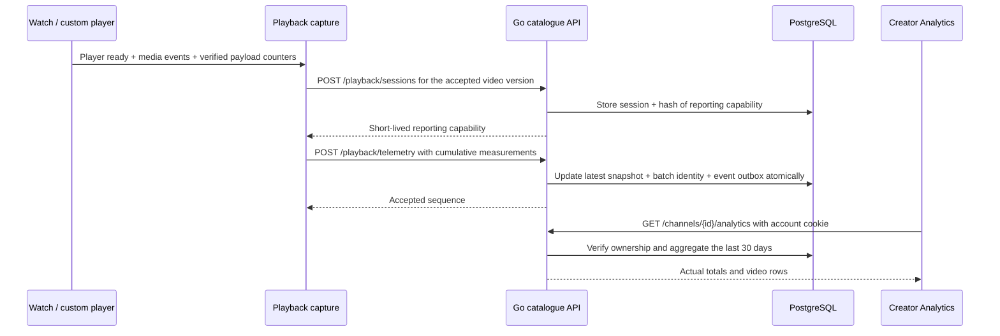

# From a watch page to creator analytics

Analytics answers a creator's practical questions: did people watch, how long did they watch, and where did the video payload come from? It uses measurements from the working player; no sample chart values are inserted. Read `apps/web/lib/playback-capture.ts`, `services/api/internal/httpapi/playback.go` and `services/api/internal/store/playback.go` alongside this chapter.

## One journey, four responsibilities

`Watch` composes playback and viewer actions. The player library understands HLS and peer transfer. The capture module understands measurement time and reporting. Go owns accepted data and creator permissions. Keeping these responsibilities apart makes it possible to change a chart without touching media delivery, or change the player without rewriting playlist APIs.

## Model the observation, not the viewer's identity

Migration `0008_playback_measurements.sql` adds four tables:

| Table               | Purpose                                             | Important identity                                  |
| ------------------- | --------------------------------------------------- | --------------------------------------------------- |
| `playback_sessions` | Current cumulative measurements for one watch visit | Session UUID plus accepted video/generation/attempt |
| `telemetry_batches` | Remember which sequence/body was accepted           | Composite `(session_id, sequence)` primary key      |
| `playback_outbox`   | Deliver accepted observations to Kafka              | Stable event UUID                                   |
| `playback_capacity` | Bound retained measurement batches                  | A single locked quota row                           |

A playback session is different from a login session. Guests can watch published videos and report observations. A random capability allows reports only for one accepted video version, expires after two hours and is stored as a SHA-256 hash. The raw token stays in the capture closure, is sent in `Playback-Token`, and is excluded from downloaded reports and events. Reporting requests omit account cookies. These tables contain no account ID, IP address or email; operational infrastructure can still observe request addresses.

Creator reads use the existing account cookie and channel ownership. Knowing a video UUID or reporting capability does not permit reading its creator's analytics. Unpublished/deleted or superseded media stops accepting reports for that old public version.

## Why cumulative counters help

Suppose the first accepted report says `http_bytes: 1000000`, and the next says `http_bytes: 1500000`. The second snapshot represents 1.5 MB received in this watch session. Sending the second body twice must still leave 1.5 MB, rather than incrementing a total twice.

The client assigns a sequence number and holds an immutable pending batch. A retry uses the same sequence and body. The database locks the session row, compares the canonical body hash for an existing sequence, and returns an acknowledgement for an identical retry. A changed body under that sequence is a conflict. For a new sequence, cumulative counters cannot go backwards. Sequence gaps are allowed because a final page-exit report can arrive before an earlier request.

The transaction updates the session snapshot, remembers the batch and inserts one outbox event together. It commits all three or none. The dashboard aggregates snapshots directly in SQL. Kafka receives the independent accepted observation stream through `peerscreen.playback.telemetry.v1`; the current dashboard is **not** a Kafka consumer projection. This avoids making a local creator dashboard wait for a broker round trip.

Switching sharing on/off rebuilds the player, whose connection counters start at zero. It does not start another logical watch session. Capture adds finished connection counters to a base and adds the current connection counters to that base. This is ordinary state modelling: decide the lifetime of the thing you measure before deciding where its counters live.

## Measuring time and delivery

| Field                           | How it is collected                                    | What it means                                                     |
| ------------------------------- | ------------------------------------------------------ | ----------------------------------------------------------------- |
| `played_ms`                     | Small clock ticks while playing, ready and not seeking | Conservative active watch time, rather than the furthest playhead |
| `startup_ms`                    | First play request to first `playing` event            | Startup duration; null if no usable sample                        |
| `rebuffer_ms`, `rebuffer_count` | Waiting after playback has started                     | Playback stalls, excluding initial startup and seeking            |
| `http_bytes`, `peer_bytes`      | Verified completed segment callbacks                   | Received media payload attributed to its source                   |
| `uploaded_bytes`                | Peer upload callbacks                                  | Payload sent to other viewers; separate from received bytes       |
| `quality`                       | Accepted decoded video height, or zero if unknown      | The current rendition                                             |
| `peer_sharing`                  | Current explicit choice                                | Earlier peer bytes remain after opting out                        |

Reports run about every ten seconds and at useful media/lifecycle events. Optional reporting failure leaves the video playable. A final small `keepalive` request improves page-exit delivery but is best effort; closing a browser cannot guarantee a final report.

Native HLS does not expose this loader's verified byte accounting. Its attribution fields remain zero internally and the UI labels the unavailable measurement. Unknown startup is represented as `*int64` in Go: a nil pointer encodes JSON `null`, while a pointer to zero is a real zero-duration sample. A SQL average excludes null samples rather than pretending they were instantaneous starts.

`qualified()` counts a session once after 30 seconds, or half the duration for a shorter video, with a one-second minimum. It is not a unique-person count. A reload creates a new session. Peer share is `peer_bytes / (http_bytes + peer_bytes)`; it is null when no attributed payload exists, and uploaded bytes are excluded from its denominator.

## The Go code in context

The HTTP handlers decode the request and pass typed structs to store methods. `UnmarshalJSON` requires the measurement fields and rejects unknown fields; this prevents a missing cumulative counter silently becoming Go's zero value. Methods receive `context.Context` so request cancellation can interrupt database work. `defer tx.Rollback(ctx)` cleans up an uncommitted transaction, while an explicit successful `Commit` saves the result.

The relay is a goroutine started with the API's lifetime context. It publishes an event before marking that event sent. If acknowledgement is ambiguous, a later send can repeat the same event UUID. Downstream consumers should deduplicate by that UUID. The producer does not promise exactly-once Kafka transport.

Validation bounds time by server elapsed time, restricts rendition choices and caps payload increments. Redis limits starts and reports; admission caps retained sessions at 20,000 and batches at 200,000. New session creation prunes up to 1,000 sessions older than 30 days and their dependent records. Cleanup is request-driven, so inactive old data can remain until another start. These are local resource limits, not a scalable analytics warehouse design.

Browser reports can be incomplete or fabricated. Use them for product feedback and learning, not billing or trusted savings claims. The test-only gateway counter separately measures streamed HTTP response-body bytes. It includes partial responses and excludes manifests/protocol overhead; it is not a CDN invoice or a packet capture.

## Try it yourself

Publish your own short video. Open its watch link in another profile, play for more than half its duration and pause. Open **Workspace → Analytics**, then its video row. Compare watch time, received payload and startup with **Connection details** on the watch page. Turn sharing on and off: the watch session remains one session while the player connection count in the downloaded report changes.

In browser developer tools, inspect the two playback request **shapes**, rather than copying tokens. Trace the handler into `RecordPlayback`, find the session-row lock, and follow the aggregate query back to the chart component. That is an end-to-end feature you can explain from UI state to SQL.
