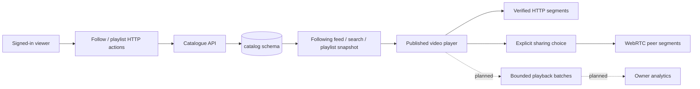

# Phase 4: viewer library, analytics and uploaded-media peer journeys

Status: implementation in progress. Phase 3's closing [CI run passed](https://github.com/darshpatel1052/Peer-Screen/actions/runs/38533968360). This guide grows with verified behavior; plans below are not claims of completed product or cross-network proof.

Phase 4 connects the existing publishing pipeline to everyday viewer actions: follow channels, find videos beyond the loaded catalogue page, save an ordered playlist, and inspect creator playback measurements. It keeps the current theme, custom player, explicit sharing consent, accounts and service boundaries.

Start with [the library data model and HTTP contracts](01-library-and-search.md). The first backend slice contains subscriptions, PostgreSQL search and owned private/public playlists. UI integration, telemetry/analytics, actual uploaded-video peer measurements and the two-network device exercise follow.

## The complete request journeys

Product relationships stay in the catalogue service. Neither a playlist nor a subscription grants access to private video media. Processing jobs and accepted outputs remain owned by the Phase 3 protocols.

The user can provide two devices/networks for a later real-world check. Local browser contexts remain labelled as a single-host measurement. Cross-network acceptance will require recorded actual payload, device/network conditions, HTTP fallback and an HTTP-only comparison; a connection icon is insufficient evidence.
