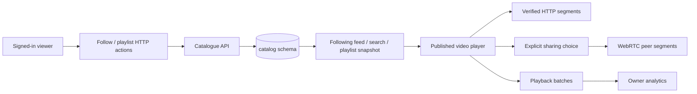

# Phase 4: viewer library, analytics and uploaded-media peer journeys

The viewer features are implemented locally: Following, server search, private/public playlists with playback queues, browser reporting and creator Analytics. The user reported successful playback across two networks; the report did not include per-device byte counters, so it remains a user confirmation rather than an independently instrumented measurement. This guide focuses on building and understanding those features.

Phase 4 connects the existing publishing pipeline to everyday viewer actions: follow channels, find videos beyond the loaded catalogue page, save an ordered playlist, and inspect creator playback measurements. It keeps the current theme, custom player, explicit sharing consent, accounts and service boundaries.

Read the chapters in this order:

1. [Library data model and HTTP APIs](01-library-and-search.md): subscriptions, PostgreSQL search, owned playlists, revisions and transactions.
2. [Playback and Analytics](02-playback-and-analytics.md): the watch-to-dashboard journey, measurement tables, Go types and aggregation.
3. [Components and hands-on exercises](03-components-and-hands-on.md): React state/effects, static routes, forms, queues and a practical feature-extension exercise.
4. [Two-network device exercise](04-device-exercise.md): how to collect a real network result once private device access is ready.

Try the complete product journey first, then trace its component, API method and SQL. The [current evidence](../../evidence/phase-4/README.md) records what was observed without making test scenarios the main product demonstration.

## The complete request journeys

Product relationships stay in the catalogue service. Neither a playlist nor a subscription grants access to private video media. Processing jobs and accepted outputs remain owned by the Phase 3 protocols.

The user can provide two devices/networks for a later real-world check. Local browser contexts remain labelled as a single-host measurement. Cross-network acceptance will require recorded actual payload, device/network conditions, HTTP fallback and an HTTP-only comparison; a connection icon is insufficient evidence.
