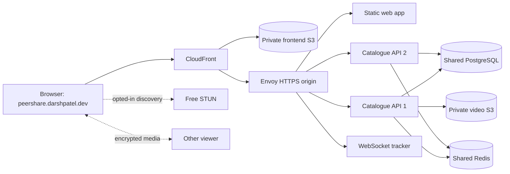

# Phase 5: deploy and operate the product

PeerShare's public hostname is **peershare.darshpatel.dev**. The deployment uses CloudFront for the static frontend and an HTTPS gateway for API, private-media authorization and WebSocket peer discovery. The distribution and public certificate are issued; hostname/application cutover is tracked in the [deployment runbook](../../runbooks/aws-deployment.md). The original direct HTTPS release remains a compatibility path during the switch.

Start with the product journey: a creator publishes a video, the frontend arrives through the CDN, Go authorizes media access, and opted-in browsers discover one another through the tracker. This phase explains the AWS resources and networking behind that journey. The existing Mumbai host, private storage and database retain their identifiers and data. The AWS account remains on its active Free plan; no plan upgrade was enabled.

1. [Peer discovery and the gateway](01-peer-and-gateway.md) explains STUN, ICE, signalling, HTTPS/WSS, replicas and trusted client addresses.
2. [AWS resources and costs](02-aws-and-costs.md) explains Terraform, the selected resources, the 24-hour cost example and safe deployment/teardown.
3. [Operating the local rehearsal](03-operations.md) explains readiness, Prometheus measurements, diagnosis and what remains before AWS provisioning.
4. [Redis caching and creator access](04-redis-and-creator-access.md) follows dashboard reads through shared caching, explains separate eviction policies, and shows production creator grants.
5. [Private storage and releases](05-storage-and-release.md) follows S3 uploads/playback, Go's storage adapter, scoped AWS roles, credential refresh, certificates, immutable images and the verified full-data backup.
6. [Metrics, dashboards and traces](06-observability.md) explains the optional operator profile, histogram queries, sampling and worker/coordinator traces.

The browser still receives verified HTTP media when direct peer connectivity is unavailable. Two API containers improve routing through an individual process outage; one host, database, broker and disk remain shared failure domains. Neither STUN nor two containers establishes universal connectivity or multi-host availability.

S3 transport, creator admission, the local full-data restore and origin-routing rehearsals have passed. Actual GitHub OIDC publication, host/data rollout, origin certificate issuance/renewal and AWS snapshot restore have passed. The local monitoring profile scraped both replicas, provisioned eight panels and captured a real worker/coordinator trace. Public CloudFront, live production Google sign-in and two-network validation remain pending. See the [full cost plan](../../runbooks/aws-cost-plan.md) for the 24-hour workload and retained-resource costs. Existing product workflows remain usable on the normal local app.
