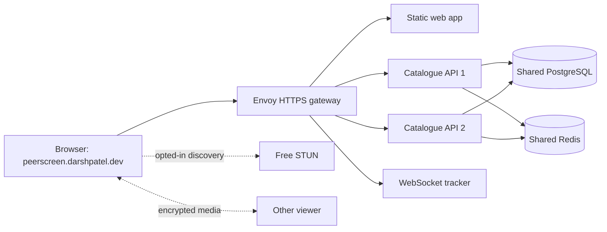

# Phase 5: deploy and operate the product

Target hostname: **peerscreen.darshpatel.dev**, selected by the user on 14 October 2026. AWS preparation must preserve the account's Free plan and credit constraint. No AWS resource has been created, DNS changed or paid plan enabled.

This first checkpoint connects real peer discovery to a deployment foundation: STUN enabled after opt-in, a WebSocket-only tracker, one HTTPS/WSS gateway, two catalogue replicas, shared sessions and private operational measurements. The Terraform starter prepares a bounded Mumbai host, disks, private storage and image repositories. It is infrastructure preparation, not a finished public deployment.

1. [Peer discovery and the gateway](01-peer-and-gateway.md) explains STUN, ICE, signalling, HTTPS/WSS, replicas and trusted client addresses.
2. [AWS resources and costs](02-aws-and-costs.md) explains Terraform, the selected resources, the 24-hour cost example and safe deployment/teardown.
3. [Operating the local rehearsal](03-operations.md) explains readiness, Prometheus measurements, diagnosis and what remains before AWS provisioning.
4. [Redis caching and creator access](04-redis-and-creator-access.md) follows dashboard reads through shared caching, explains separate eviction policies, and shows production creator grants.

The browser still receives verified HTTP media when direct peer connectivity is unavailable. Two API containers improve routing through an individual process outage; one host, database, broker and disk remain shared failure domains. Neither STUN nor two containers establishes universal connectivity or multi-host availability.

The next implementation slices are S3 application transport and publication/revocation behavior, creator admission, certificate issuance/renewal, scoped IAM and image delivery, full backup/restore, tracing/dashboards, the remaining cost inputs, and actual public/two-network validation. Existing product workflows remain usable on the normal local app while those deployment pieces are built.
