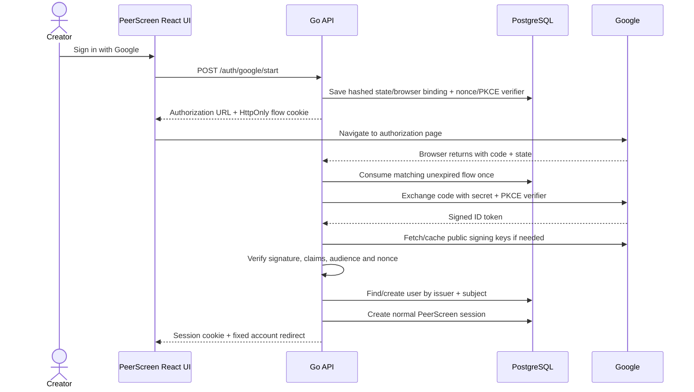

# Google sign-in: the concepts and PeerScreen implementation

Prepared 14 October 2026.

## Cost and the one setup step still needed

The direct Google sign-in integration uses our Go server and PostgreSQL sessions. Creating the Google account/project needed to register the app is free, as Google's [sign-in codelab](https://codelabs.developers.google.com/codelabs/sign-in-with-google-button) explains. Registering an OAuth client does not move PeerScreen's hosting to Google. We request only identity information, not paid Google APIs or a managed authentication service.

The integration is implemented and tested, but this machine has no Google client credentials configured. The UI therefore shows Google as unavailable. A live login cannot be claimed until a real client is registered and tested. Email/password continues to work.

A Google Cloud project is a container for the app registration. An OAuth **client ID** identifies PeerScreen. Its **client secret** belongs on the Go server. A **redirect URI** tells Google where the browser should return. Google's [OIDC documentation](https://developers.google.com/identity/openid-connect/openid-connect) requires these credentials for the server flow.

## Authentication, sessions, and authorization

| Concept        | Question                                   | Our implementation                                                      |
| -------------- | ------------------------------------------ | ----------------------------------------------------------------------- |
| Authentication | Who signed in?                             | Argon2id password verification or a verified Google ID token            |
| Session        | How do later requests recognize that user? | Random HttpOnly cookie, with only its SHA-256 hash stored in PostgreSQL |
| Authorization  | What can that user change/read?            | Existing user/channel ownership and publication checks                  |

Google is another way to establish identity. It does not own your PeerScreen channel, grant upload permissions, or replace logout. The callback issues the same session format already used by password sign-in. Existing expiration, session cap, and logout-everywhere behavior therefore apply.

OAuth 2.0 is an authorization protocol. OpenID Connect adds an identity layer and a signed ID token. An **authorization code** is a short-lived value exchanged by the server; an **ID token** contains identity claims that must be verified. An access token answers a different question: what provider APIs may be called. PeerScreen does not save provider access tokens or request offline refresh access. See the [OIDC specification](https://openid.net/specs/openid-connect-core-1_0.html).

## The actual flow in this repository



The React button makes a same-origin POST, then navigates to the returned Google authorization URL. The server callback is proxied through the same app origin as our other APIs. This keeps cookie behavior consistent with password sign-in and lets the frontend remain a static export.

Google's public endpoints are configured directly from its [discovery document](https://accounts.google.com/.well-known/openid-configuration). The application exposes no environment setting to replace the trusted issuer or signing-key URL. Tests inject a local provider into the Go application object; there is no runtime “skip verification” switch.

## Why we added two database tables

Migration `0005_google_identity.sql` allows `users.password_hash` to be NULL for an account created through Google. It adds:

| Table/field                     | What it records and why                                                |
| ------------------------------- | ---------------------------------------------------------------------- |
| `external_identities.issuer`    | Which provider issued this identity                                    |
| `subject`                       | Its stable account identifier, Google `sub`                            |
| `user_id`                       | The existing PeerScreen user it authenticates                          |
| `provider_email`                | Display information for the connection, not the login key              |
| Primary key `(issuer, subject)` | One provider identity cannot belong to two local users                 |
| Unique `(user_id, issuer)`      | One Google connection per PeerScreen user                              |
| `oauth_flows.state_hash`        | Hash of the random state sent in the authorization URL                 |
| `browser_hash`                  | Hash of the random HttpOnly cookie binding this flow to this browser   |
| `nonce`                         | Value that must return inside the verified ID token                    |
| `code_verifier`                 | Temporary secret needed to exchange the code using PKCE                |
| `purpose`                       | Either sign-in or explicit account connection                          |
| `user_id` / `session_hash`      | Original account and exact password-confirmed session for a connection |
| `expires_at`                    | Ten-minute validity window                                             |

Google documents using `sub` as the identity key rather than email in its [ID-token guidance](https://developers.google.com/identity/openid-connect/openid-connect#an-id-tokens-payload). Our code demonstrates the consequence: if the same Google subject later returns a different email, it still resolves to the original local user and channel. The local primary email is not silently changed.

The flow record is temporary, not a session or saved Google credential. State and browser-cookie values are hashed. The verifier exists only to finish this one exchange. Successful consumption deletes the row atomically; expired rows are pruned when a new flow starts. Admission bounds the table at 1024 pending flows. A restart can preserve an unexpired flow because it lives in PostgreSQL.

## State, browser binding, nonce, and PKCE do different jobs

- **State** matches the provider response to a flow we started.
- **Browser binding** requires the original HttpOnly flow cookie. Knowing someone else's authorization URL is insufficient to complete it in a different browser.
- **Nonce** must match inside the verified token, binding that identity response to this particular attempt.
- **PKCE S256** sends a SHA-256 challenge first and the secret verifier only during the server exchange. An intercepted code alone cannot satisfy that exchange.

The callback deletes a valid matching flow before contacting Google. Consequently a provider failure or invalid token also consumes it: retry means start a fresh flow. An invalid browser binding does not consume someone else's record. Cancellation consumes the valid flow without exchanging a code.

All flow-starting POSTs require the configured Origin and pass the existing Redis-backed authentication rate limiter. Cookies are HttpOnly and SameSite=Lax; production uses Secure `__Host-` cookies. Callback redirects go only to fixed PeerScreen account/settings destinations, with short product result codes. Raw Google errors, codes, tokens, and secrets are not reflected in messages or request logs. The callback sets `Referrer-Policy: no-referrer` and `Cache-Control: no-store`.

## What Go verifies

`github.com/coreos/go-oidc/v3` v3.21.0 handles ID-token signature verification and public-key caching. `golang.org/x/oauth2` v0.37.0 handles the authorization URL, token exchange and PKCE parameters. These are pinned in `go.mod`/`go.sum`. The [OIDC library documentation](https://pkg.go.dev/github.com/coreos/go-oidc/v3/oidc) describes the verifier APIs.

Our verifier requires Google's issuer, our client ID as audience, an unexpired token, and RS256 signatures. The application additionally checks the nonce, stable subject, verified/valid email, issued-at time, and authorized party (`azp`, required for multiple audiences). Missing or mismatched values fail before a local identity or session is created. We never use unverified decoded JWT data to create a user.

A Go `struct` defines the configuration or claim fields we expect. JSON tags map external names such as `email_verified` to Go fields. A pointer such as `*string` distinguishes an absent connection/session owner from a real value. `context.Context` carries cancellation/deadlines through HTTP exchange and SQL calls. `defer tx.Rollback(ctx)` releases a failed transaction, while `Commit` makes its changes authoritative. `errors.Is` handles known failures without returning the provider's potentially sensitive error body.

## Existing password accounts: why linking is explicit

Imagine your password account already owns a channel. Someone presents a Google token whose email matches that account. Treating that match alone as permission to merge identity methods would change how an existing account can be accessed. Instead, Google sign-in returns a readable message telling you to sign in with your password and connect Google in Settings.

The connection flow requires:

1. A currently authenticated PeerScreen session.
2. Confirmation of that account's existing password, using the existing Argon2id verifier.
3. A valid Google authorization and signed identity.
4. The exact same active session when Google returns.
5. A transaction that checks the original session again and refuses an identity belonging to another user.

The transaction preserves `users.id`, `channels.owner_id`, channel metadata, and videos. It adds an external identity row. Logging out everywhere while a connection is pending makes the callback fail. A different Google identity cannot silently replace an existing connection. We have not added an unlink action that could strand a Google-only user without a sign-in method.

Google-only password attempts use the existing dummy password hash and generic invalid-credentials response. A NULL password hash never becomes an empty or generated password.

## API map and React components

| Endpoint                    | Responsibility                                                              |
| --------------------------- | --------------------------------------------------------------------------- |
| `GET /auth/options`         | Announces provider availability, without exposing credentials               |
| `POST /auth/google/start`   | Starts an anonymous Google sign-in attempt                                  |
| `POST /auth/google/link`    | Starts password-confirmed connection for the current user                   |
| `GET /auth/google/callback` | Consumes the flow, verifies identity, connects or creates the local session |
| `GET /auth/methods`         | Shows the current user's password/Google methods                            |

All paths above have the `/api/v1` prefix. The OpenAPI contract generates the frontend's `AuthOptions`, `AuthMethods`, and `OAuthRedirect` types.

`GoogleSignIn` handles availability, password confirmation when connecting, the start request, and recoverable errors. It uses Google's unmodified pre-approved button images and rejects a returned navigation URL outside `https://accounts.google.com`. `SignInSettings` displays the connected methods. `AuthFeedback` translates the callback's fixed result code and then removes it from the visible URL. These components do not receive the client secret or provider token.

## Free local setup

Follow Google's [client and branding setup](https://developers.google.com/identity/gsi/web/guides/get-google-api-clientid) while completing these PeerScreen-specific values:

1. Create/select a Google Cloud project, then open **Google Auth Platform**.
2. Configure branding with PeerScreen as the app name and your support contact. For development, use an external audience/testing configuration and add your Google account as a test user when required.
3. Use only `openid`, `email`, and `profile` identity scopes.
4. Under **Clients**, create a **Web application** client.
5. Set the authorized redirect URI exactly to:

   ```text
   http://localhost:3000/api/v1/auth/google/callback
   ```

6. Google may also offer Authorized JavaScript origins; `http://localhost:3000` can be listed there. Our server redirect flow depends on the redirect URI above, not a browser token callback.
7. Save the client ID and secret in this repository's ignored `.local/google.env`, with no quotes around values:

   ```dotenv
   GOOGLE_CLIENT_ID=your-client-id.apps.googleusercontent.com
   GOOGLE_CLIENT_SECRET=your-server-only-secret
   ```

8. Restrict that file's permissions to your user (`chmod 600 .local/google.env`). Restart with the existing local app command, `npm run compose:demo`. On this machine's Docker setup, the build command uses `PEERSCREEN_BUILD_NETWORK=host npm run compose:demo`; that option changes build networking, not runtime network isolation.
9. Use `http://localhost:3000` consistently. A different port, `127.0.0.1`, or a trailing slash on the callback is a different registered redirect URI.
10. For your existing account, choose **Workspace → Settings → Sign-in methods**, confirm your password and use the Google button. After connection, sign out and sign in with Google; your channel should be the same channel.

The local scripts also accept `GOOGLE_CLIENT_ID` and `GOOGLE_CLIENT_SECRET` in `.local/local.env`, if you already added them there. Process environment values override that shared file; a dedicated `.local/google.env` overrides both. Test runtimes skip the dedicated Google file and clear both provider values, even when the shared file or process environment contains them. Credentials enter the API container's runtime environment, not the web container or frontend build. Never paste the secret into chat, commit it, or put it in a `NEXT_PUBLIC_` variable.

Registering the client is enough for this integration; our implementation does not require paid compute, Cloud Storage, Firebase Authentication, or Identity Platform. Public release will need real HTTPS origins, appropriate app branding/domain information, Google's applicable verification requirements, and our separate public admission/deployment work.

## What is verified versus still unverified

The Go integration suite runs the real callback, PostgreSQL identity/session writes, OAuth code exchange, PKCE, and RSA signature verification against a disposable local provider with a real JWKS endpoint. It covers successful sign-in, stable-subject email changes, admission closure, password-only collision handling, explicit linking, identity reassignment rejection, revoked linking sessions, invalid claims/signatures, expired/cancelled flows, missing browser binding, provider exchange failures, callback replay, atomic one-use consumption under eight simultaneous attempts, and concurrent admission of the same provider subject.

The browser suite verifies disabled unconfigured sign-in, clear collision feedback, the Settings route, password confirmation before a connection request, and recovery from unavailable-provider responses. Its controlled availability response is explicitly documented as a UI test, not a simulated successful Google login.

A real Google account has not completed this flow yet because no OAuth client credentials are configured. The code and local evidence do not claim otherwise.
