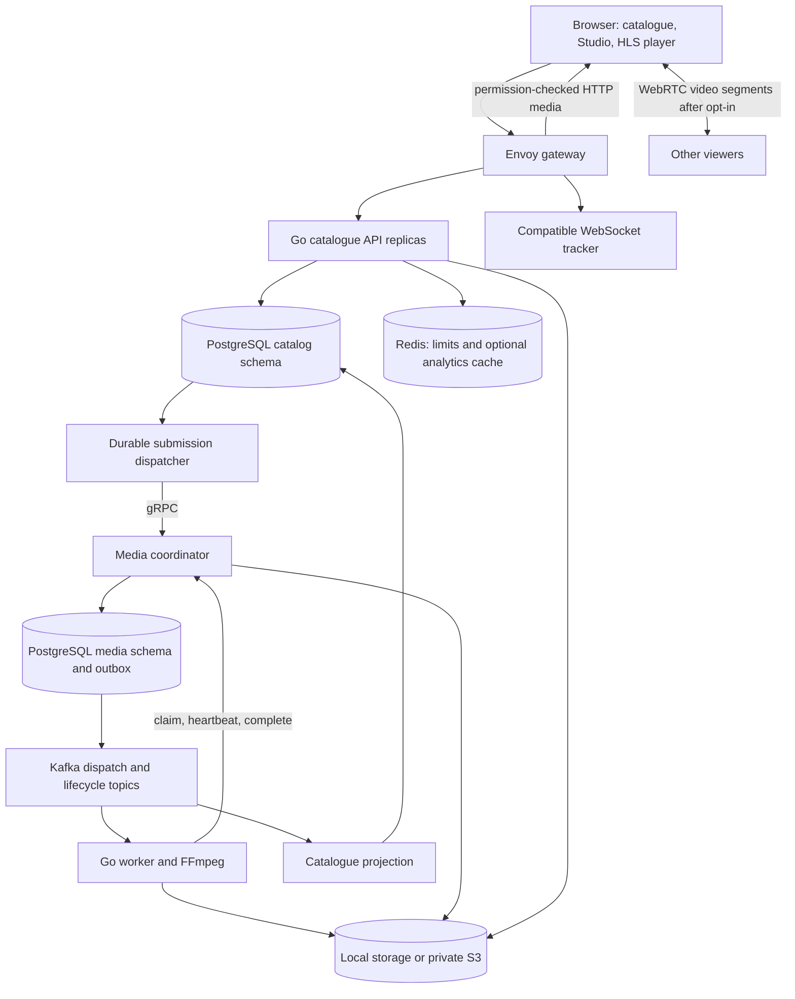

# Explain PeerShare from top to bottom

Prepared from the actual implementation during the 15 October 2026 project review. Pair this with the [review and remaining issues](../reviews/2026-10-15-project-review.md). Existing phase guides provide deeper code exercises; this document connects them into one interview narrative.

## 1. The short explanation

PeerShare is a video publishing and viewing application. A creator uploads an MP4 in recoverable, checksum-verified chunks. Background workers validate and transcode it into adaptive HLS. The creator previews and publishes the accepted output. Viewers watch over HTTP and can explicitly opt into exchanging verified video segments with other viewers through WebRTC. Channels, search, following, playlists and creator analytics make that delivery system usable as a product.

Its engineering focus is durable asynchronous work: uploads survive interruptions, jobs survive process loss, duplicate notifications are safe, and an obsolete worker cannot publish over a newer attempt. The first AWS deployment uses one bounded host with private S3; local Helm exercises demonstrate Kubernetes packaging and API process scaling.

A good 60-second explanation:

> I built PeerShare, a video publishing platform with recoverable uploads, adaptive HLS and opt-in peer-assisted delivery. The Go catalogue API owns product data, while a separate gRPC coordinator owns processing jobs and worker leases. Kafka carries notifications; PostgreSQL owns durable job state. Transactional outboxes and idempotent commands handle retries, and attempt epochs prevent stale workers from publishing. FFmpeg creates immutable rendition outputs that are independently verified before acceptance. The browser checks segment hashes for HTTP and peer media and falls back to HTTP when peers disappear. I packaged it with Docker, Terraform and AWS releases, added operational dashboards and restore checks, and exercised the same deployment locally with Helm. The current cloud topology is a single host, and my peer measurements have clearly stated browser and network scope.

Be ready to explain every sentence. The review found remaining edge cases in interrupted-error classification, cancel/retry intent, storage accounting and client state; acknowledge them if discussing completeness.

## 2. The architecture



There are three main Go executables in one module: `cmd/peerscreen`, `cmd/media` and `cmd/worker`. Source packaging and runtime separation are different concepts. They can share contracts and encoder helpers while running as independent processes with different credentials.

The catalogue and media schemas share a physical PostgreSQL server in this deployment. Distinct service credentials enforce ownership. The worker has RPC/storage credentials rather than a database connection. Kafka, Redis and PostgreSQL stay inside the service network. The tracker exchanges signalling messages; it does not host the video.

Read [the architecture chapter](phase-3/01-architecture-and-ownership.md) and [service-boundary ADR](../adr/0004-media-services-and-durable-events.md).

## 3. Follow one upload

1. The signed-in creator chooses a file and supplies title, description and tags. The browser calculates part fingerprints. Source limits are 250 MiB and ten minutes.
2. The API checks ownership, production creator approval, expensive-request admission and storage/active-upload capacity. PostgreSQL serializes capacity decisions so simultaneous replicas cannot both admit the same remaining space.
3. Upload setup creates a private draft and durable upload session. An idempotency key identifies the logical setup request; changed input with the same key is a conflict.
4. The browser requests bounded part permissions, then sends 8 MiB chunks in batches of three. The API checks actual length and SHA-256, writes immutable part storage and records authoritative part metadata.
5. Pause stops additional work. After a network interruption or browser restart, the creator reselects the original file. Resume asks the server which verified parts exist; the browser does not assume its old progress is authoritative.
6. Complete verifies and assembles the source. The source metadata, local job/read model and durable submission commit together. The HTTP request returns without waiting for video encoding.
7. A background dispatcher retries submission over gRPC with a stable job ID and immutable specification. An ambiguous timeout can be safely retried.

**Important implementation detail:** the current protocol sends chunks through the API. In S3 mode those chunks become private S3 objects and the server assembles a canonical source. It does not implement native browser-to-S3 multipart upload. This is an explicit tradeoff: simpler ownership/checksum/quota enforcement at the cost of host bandwidth and extra byte handling.

Read [upload/data/API explanations](phase-2/README.md), then inspect `internal/httpapi/uploads.go` and `internal/store/uploads.go`.

## 4. Follow the processing job

The coordinator persists a job plus a dispatch-outbox record in one transaction. A relay publishes the record to Kafka. The worker treats it as a notification to claim durable work, not permission to encode immediately.

Claim grants an attempt ID, worker identity, lease expiry and increasing epoch. The worker commits the Kafka notification after a durable claim/no-op decision, then runs bounded FFprobe/FFmpeg work. It heartbeats approximately every ten seconds against a sixty-second lease. The coordinator uses database time for lease decisions.

The encoder validates actual MP4 content and media metadata, enforces duration/dimension/output bounds, selects source-appropriate qualities and avoids upscaling. It generates H.264/AAC HLS, normally 480p/720p for sufficiently large sources, thumbnails and an integrity/output descriptor. Segments are approximately four seconds, subject to actual media boundaries.

Outputs live under an immutable video/generation/attempt prefix. The descriptor records the output inventory and hashes. The coordinator independently validates the files before accepting completion, then rechecks the live lease/attempt/epoch under its database lock. A successful computation with an obsolete capability is rejected.

The coordinator commits accepted state and a lifecycle outbox entry together. The catalogue projection receives a notification, obtains authoritative job state, then applies generation/version guards and durable deduplication. The video becomes ready for preview. It remains private until the owner publishes.

Implemented coordinator states are conceptually:

```text
queued → running → ready
             ├→ retry_wait → queued
             └→ failed
queued/retry_wait/running → cancel_requested/cancelled
```

The catalogue has a separate processing projection and publication state. “Ready” and “published” answer different questions.

Read [adaptive media](phase-3/05-adaptive-media.md), [Kafka/recovery](phase-3/04-kafka-and-recovery.md) and `internal/mediasvc/{store,rpc,worker,kafka}.go`.

## 5. The four reliability concepts you must understand

| Concept                  | Problem it solves                                                             | PeerShare example                                                                             |
| ------------------------ | ----------------------------------------------------------------------------- | --------------------------------------------------------------------------------------------- |
| Idempotency              | A caller retries because the response was lost                                | Same upload key or job specification returns the same logical result; changed input conflicts |
| Transactional outbox     | Database commit and event publication cannot be one ordinary atomic operation | Persist state and an outgoing record together, then retry broker publication                  |
| Inbox/version guard      | At-least-once delivery repeats or reorders observations                       | Commit deduplication and the catalogue update together; reject obsolete versions/generations  |
| Lease plus fencing epoch | A paused/crashed worker can return after reassignment                         | Expire ownership, create a new attempt/epoch, reject old heartbeats/completion                |

A lease alone is insufficient. Worker A can stop responding, lose its lease, then resume after worker B starts. The epoch prevents A's late result from being accepted. Immutable attempt paths prevent it overwriting B's files.

An outbox relay can publish successfully and crash before marking the row sent. It will publish again. The solution is duplicate-safe effects, not a blanket “exactly once” claim.

If a worker dies after Kafka acknowledgement, the lease reaper repairs the durable job and redispatches it after expiry. Periodic queued-job reconciliation repairs ineffective notifications. Kafka is useful for delivery and decoupling, while PostgreSQL remains authoritative for acceptance and recovery.

One newly found defect illustrates why testing matters: a cancelled FFmpeg subprocess is currently marked permanent in some interruption paths. Another lets a higher-version cancellation erase a newer retry command. The architecture supports recovery, but those code paths need correction.

## 6. Playback and peer assistance

HLS represents a video using a master playlist, rendition playlists and small media segments. The master lets the player choose among qualities. HLS.js feeds supported browsers through their media capabilities; this project also has a native-HLS fallback with different measurement guarantees.

Normal HTTP playback works with peer sharing off. After explicit consent, the player loads its peer integration, joins a swarm and uses the compatible WebSocket tracker to discover other viewers. Peers exchange WebRTC offers/answers through signalling, then media bytes travel over WebRTC data channels.

The swarm identity includes the video and accepted output version. Different generations/attempts must not exchange apparently matching segment identifiers. A trusted integrity descriptor binds expected segment paths, lengths and SHA-256. HTTP and peer paths validate bytes before handing them to playback. The custom HTTP loader buffers until verification rather than progressively exposing unchecked bytes.

STUN discovers a public-facing address; it does not relay media. TURN would relay where direct connectivity fails, and is not provisioned here. Real-world NAT/firewall combinations can prevent peer connectivity. HTTP fallback makes that a delivery degradation rather than a requirement that every viewer find peers.

Consent matters because viewers spend upload bandwidth and peers/discovery services can learn network addresses. Sharing defaults off, is remembered per accepted video/version within the tab, and closes connections on opt-out/navigation.

Read `packages/player/src/{index,integrity,http-loader}.ts`, `services/tracker/server.mjs`, and [the device exercise](phase-4/04-device-exercise.md).

## 7. Identity, authorization and data integrity

Passwords use Argon2id with bounded hashing concurrency. Sessions are random opaque tokens; only hashes are stored in PostgreSQL. Cookies use HttpOnly and SameSite policies, with production Secure/host constraints. Sessions expire and can be revoked, including logout-all.

Google OIDC establishes the external identity using signed claims, audience/issuer/expiry checks, nonce, browser-bound one-time state and PKCE. Account linking is explicit and password-confirmed for existing password accounts. Matching email alone does not automatically merge accounts.

Authentication answers “who is this?” Authorization answers “does this owner control this channel/video/playlist?” Backend checks canonical ownership. A disabled frontend button cannot enforce that boundary. Exact Origin checks protect authenticated writes; production registration and creator grants limit public-demo resource admission.

Foreign keys, uniqueness and SQL checks encode business invariants. Metadata updates use revisions to detect stale edits rather than silently overwrite them. Public lists/read paths exclude unpublished/deleted media. Media reads check accepted generation/attempt and publication or owner access before returning local/S3 bytes.

Unpublishing stops subsequent authorized origin requests; already downloaded or peer-cached bytes cannot be recalled. The first deployment keeps media uncached through the permission gate to preserve that subsequent-request behavior.

Read [identity/API chapter](phase-1/04-api-and-auth.md), [Google guide](product-and-google/02-google-sign-in.md) and the catalogue migrations.

## 8. Product data and frontend state

| Feature   | Main idea                                                                                            |
| --------- | ---------------------------------------------------------------------------------------------------- |
| Following | A unique user/channel relationship and filtered catalogue query                                      |
| Search    | PostgreSQL text search/indexes and stable cursor pagination                                          |
| Playlists | Owned parent/child records, unique ordered items, visibility and revision checks                     |
| Studio    | Persistent upload/processing/publication data with pause/resume, metadata, preview and owner actions |
| Watch     | URL-selected video/playlist, media lifecycle effects, custom controls and consent state              |
| Analytics | Bounded, deduplicated playback observations and owner-authorized aggregation                         |

The frontend is a static Next.js export. Fixed routes such as `/watch?v=...` work without a Node application server at runtime. Go supplies product data through typed API contracts. Local static files and hashed assets still need coherent deployment/cache handling; old tabs can request previous lazy chunks after a release. The latest host tooling retains a bounded set of those immutable assets.

React effects own listeners/player instances and clean them up when dependencies change. Request state must include loading, success, empty, error and retry. Unsaved form data should survive failed requests. Auth changes must invalidate private state; the new Watch playlist finding is an example of a missing dependency boundary.

Read [frontend chapter](phase-1/05-frontend.md), [library guide](phase-4/01-library-and-search.md) and `apps/web/lib/{api,use-resource}.ts`.

## 9. Explain the analytics honestly

Browser observers measure active playback, startup/rebuffering and verified HTTP/peer payload. Reports use bounded session capabilities, cumulative counters and sequence numbers. Repeating the same sequence/body is safe; conflicting or implausible observations are rejected. Related observation events use a transactional outbox.

A qualified play uses active watched time at least `min(30 seconds, max(1 second, half the video duration))`. Seeking to a timestamp is not the same as watching that amount of time. Repeated telemetry does not repeatedly count one session's cumulative totals.

Creator reads check ownership even when the optional shared Redis analytics cache is hit. That cache has a short TTL, metadata-sensitive keys, explicit refresh and PostgreSQL fallback; the authentication limiter uses separate Redis memory/policies.

These are client-reported observations with validation, not trusted billing measurements. Verified segment payload excludes transport overhead. Native playback can leave byte measurements unknown. An analytics percentage is meaningful only with its defined denominator and measurement mode.

Read [playback and analytics](phase-4/02-playback-and-analytics.md) and `internal/store/playback.go`.

## 10. Deployment and operations

Docker Compose runs the gateway, API replicas, coordinator, worker, tracker/web runtime, PostgreSQL, Kafka and Redis. Separate health/readiness checks let Envoy choose healthy API endpoints. Shared database/session state lets another replica serve the same cookie.

Terraform describes the AWS host/network/storage/roles and optional edge resources. GitHub Actions builds immutable commit-tagged images; OIDC avoids permanent CI access keys. The deployment uses private S3 for media, scoped temporary service roles and controlled host credential refresh. Release tooling stops writers during migration/update, preserves live credentials/data, switches coherent artifacts and retains compatible static chunks.

Public direct HTTPS now works at `peerscreen.darshpatel.dev`. CloudFront remains a separate pending deployment path. Media currently passes through the permission-checked host, so the mere existence of CloudFront code does not mean CDN video delivery is live.

Prometheus scrapes metrics; Grafana presents operational dashboards; OpenTelemetry/Jaeger supply traces. The documented Kafka boundary starts a separate worker attempt trace rather than proving a continuous browser-to-Kafka trace. Request/job/attempt identifiers help connect incidents across records.

Backup value comes from a successful restore, not just creating an archive. Preserved records include isolated database/media restoration and matching file hashes. A single host/database/broker/disk remain common failure domains. Fixed shutdown and bounded resources control a demo's duration; retained storage/address costs still need lifecycle management.

The Helm chart was exercised on local single-node kind. Two APIs, later three, had ready endpoints and distinct responding replicas. This proves useful packaging/probe/scaling behavior. It does not prove multi-node availability or an EKS deployment.

Read [operations](phase-5/06-observability.md), [storage/releases](phase-5/05-storage-and-release.md), [Kubernetes](phase-6/02-kubernetes.md), and [AWS runbook](../runbooks/aws-deployment.md).

## 11. Explain the technology choices and costs

| Choice            | Reason                                                               | Tradeoff to acknowledge                                                                       |
| ----------------- | -------------------------------------------------------------------- | --------------------------------------------------------------------------------------------- |
| Go                | Typed API/RPC/backend concurrency and independent service binaries   | More explicit plumbing and lifecycle handling                                                 |
| PostgreSQL        | Transactions, constraints, durable jobs and authoritative ownership  | Shared physical database is a common failure domain                                           |
| gRPC/protobuf     | Typed, bounded internal job commands                                 | Contract/version/auth/deadline work                                                           |
| Kafka             | Durable notifications, replay and decoupled consumers                | A database queue could serve this demo more simply; broker/consumer operations add complexity |
| Redis             | Shared atomic limits and disposable cached aggregation               | Availability/memory policy matters; it does not own job correctness                           |
| FFmpeg/HLS        | Real bounded adaptive processing and segment-based playback          | CPU/storage cost and careful subprocess/resource/error handling                               |
| WebRTC            | Optional browser-to-browser segment transfer                         | NAT/privacy/upload-bandwidth constraints and variable peer availability                       |
| Envoy             | Gateway routing, health checks, TLS/WSS and trusted address handling | Configuration and discovery complexity                                                        |
| Static Next.js    | Product frontend without a runtime SSR server                        | Fixed-route and asset-lifecycle constraints                                                   |
| Private S3        | Durable object adapter and immutable outputs                         | API-mediated transfers cross the host; cleanup/accounting must handle partial failures        |
| Single cloud host | Affordable bounded demonstration                                     | Shared failure domains; process replicas cannot remove them                                   |

If asked whether the service split is necessary for current traffic, say that the workload is small and a modular monolith could serve it. The explicit boundaries let you demonstrate independently recoverable workers, typed commands and durable handoffs. The project's merit is in implementing and explaining the guarantees, including their operational cost.

## 12. Questions to rehearse

1. **What happens if the API commits completion but crashes before gRPC submission?** The persistent submission remains and the dispatcher retries the stable job ID.
2. **What if the coordinator stores a job but its response is lost?** Equivalent submission is idempotent; conflicting immutable input is rejected.
3. **What if an event is published twice?** Stable event identity plus transactional deduplication/version checks protect effects.
4. **What if a worker dies after acknowledging Kafka?** The persisted lease expires; the coordinator redispatches, and a new epoch fences the old attempt.
5. **Why not hold the Kafka record unacknowledged during encoding?** The short durable-claim handoff decouples consumer acknowledgement from long media work; it requires the reaper/reconciliation to close the recovery window.
6. **What stops a deleted video reappearing?** Current video/generation/deletion checks fence projection; storage visibility is separately checked on reads.
7. **What stops a malicious peer corrupting playback?** Trusted expected length/hash checks before consumption, plus rejection/fallback. Hashes do not establish the author or license of the source.
8. **Does peer sharing always reduce cost?** No guarantee. It requires usable overlapping peers, and the current benchmark does not compare equivalent media work. Report observed peer payload and conditions.
9. **Why can a user retry a request safely?** Idempotency keys, immutable job input, uniqueness and transactions give repeatable logical outcomes.
10. **How do two API replicas share sessions and limits?** PostgreSQL session hashes and Redis atomic counters; no replica-local session authority.
11. **How would you scale beyond one host?** First measure bottlenecks; externalize shared durable services/storage appropriately, add workload-native credentials/TLS, size partitions/worker capacity, and test independent failure domains. Describe this as future design, not deployed work.
12. **What did review find?** Explain one exact bug, its interleaving and a deterministic regression. Finding a limitation and reasoning correctly about it is good engineering evidence.

## 13. Resume wording you can support

Choose two or three bullets that fit the role and space. Use “designed” or “implemented” only where you can explain your decisions and code, including assistance you used if asked.

- Built PeerShare, a Go/Next.js video publishing platform with checksum-verified resumable uploads, FFmpeg-generated adaptive HLS, creator channels, ordered playlists and playback analytics.
- Implemented gRPC media coordination, Kafka outboxes, PostgreSQL-backed job leases and epoch-fenced output acceptance; validated replay, stale completion and process recovery with integration and failure experiments.
- Integrated opt-in WebRTC segment delivery with SHA-256 integrity checks and HTTP fallback; verified actual media transfer between independent Chromium viewers.
- Containerized and deployed a bounded AWS demo with Terraform, private S3 and GitHub OIDC releases; added monitoring/tracing, restore validation and a local Helm/kind replica-scaling exercise.

You can add **57 top-level integration tests with race detection and 25 Chromium journeys** as verification detail when useful. Test count alone does not describe product impact. The currently archived local media round observed **5.64 MB peer payload** across three browsers; include that local scope if using the number. Earlier three-round summaries need a matching raw archive, as explained in the review. The public same-workstation smoke separately observed peer payload through real HTTPS/WSS.

Inspected public metadata records show **1,800 successful requests, zero errors**, with **p95 45.50–69.38 ms at eight concurrent requests** across three short 300-request rounds over a one-video catalogue. Those are useful bounded observations; they are not a capacity limit. Read the [conditions and raw records](../evidence/phase-6/performance/README.md) before using a metric.

Avoid unsupported claims of percentage CDN savings, internet-scale throughput, a guaranteed concurrent-viewer count, universal NAT traversal, multi-host availability, native S3 multipart or AWS Kubernetes. Add deployment latency/load figures only with the exact dataset, duration, concurrency, error count and scope.

## 14. A practical learning and demonstration order

1. Draw the architecture from memory and explain who owns each record and byte transfer.
2. Trace one real upload through HTTP handlers, SQL, submission, RPC, Kafka, worker, acceptance and publication.
3. Explain the four reliability concepts using an actual crash/duplicate/stale-result scenario.
4. Trace a verified HTTP segment and then the same type of segment through the peer path.
5. Explain identity/ownership and one denied operation using the backend code.
6. Walk through a playlist revision conflict and a cumulative analytics retry.
7. Run the local demo and approved isolated tests; read the result artifacts and state their scope.
8. Show dashboards, a real trace, a restore result and local Helm evidence.
9. Finish with current limits and the next measurement, including the physical two-network exercise.

Prepare a short owned demonstration video with a meaningful title and thumbnail. A useful recording, an interrupted upload that resumes, a real worker recovery and visible peer bytes will communicate the project more effectively than a technology inventory. Aim to answer the questions above without reading this guide; then use the code links to go deeper.
