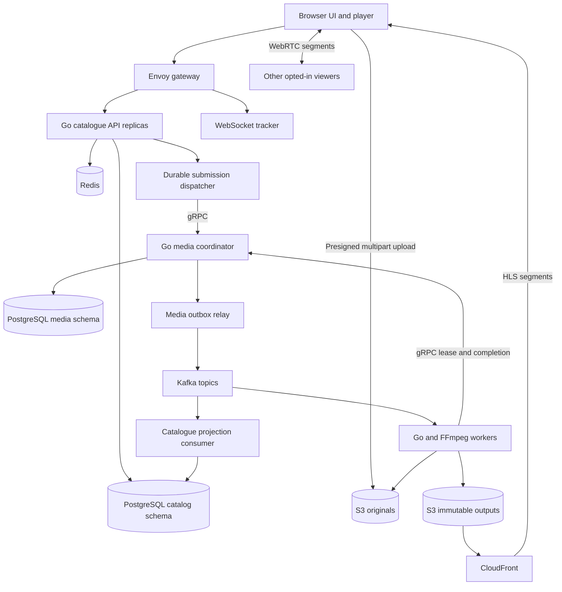

# PeerScreen — complete project handoff

Prepared on 12 October 2026. This is a proposed implementation brief, not a report of an existing implementation. Product defaults below are design decisions for this project; dependency versions, AWS eligibility, and prices must be verified when implementation or deployment begins.

## 1. Context and objective

Build **PeerScreen**, a complete video publishing and viewing application with **peer-assisted delivery**. Creators upload and publish videos. Viewers browse channels, watch videos, and optionally help deliver downloaded video segments to other viewers of the same video. Reliable HTTP delivery remains available through an origin/CDN.

The user wants a useful, non-AI product that demonstrates backend engineering, system design, and DevOps. Their existing portfolio includes DevSentinel, Askify, and AlgoViz. The recommendation in this conversation was to replace Askify with PeerScreen after PeerScreen is implemented, deployed, and supported by evidence. No resume claims about PeerScreen have been earned yet.

The user already has experience with TypeScript, React/Next.js, Python web frameworks, SQL, PostgreSQL, Docker, streaming APIs, and cloud deployment. Go is the recommended additional backend language. Learning several new backend languages at once is unnecessary.

### Confirmed constraints

- The user has an AWS **Free plan**, with **USD 100 of credits remaining** at the time of this conversation.
- Their AWS console context was Mumbai, `ap-south-1`; use Mumbai as the deployment default, subject to service availability and a fresh cost estimate.
- The account display states that service access ends when credits are depleted or the free period ends.
- Preserve the Free plan. This brief does not authorize upgrading the account.
- Develop locally first. Use AWS for a public demonstration and bounded infrastructure experiments.
- This handoff creates no infrastructure and assumes no deployed application or existing PeerScreen repository.
- No AWS account IDs, keys, passwords, or other credentials are included in this document.

### What success looks like

A creator can upload a bounded-size video, recover an interrupted upload, follow processing progress, publish it, and manage it. A viewer can browse the catalogue and play it through HTTP/CDN delivery. Several opted-in viewers can exchange actual video bytes over WebRTC. A creator dashboard reports measured HTTP-versus-peer delivery. Processing and publication recover correctly from interrupted services. The repository includes reproducible local deployment, a costed AWS deployment, operational documentation, and honest benchmark evidence.

## 2. Product definition

PeerScreen is a video application with a catalogue, channels, playlists, a watch page, and a creator workspace. Peer assistance is the delivery mechanism that makes its infrastructure interesting.

Possible early users include college clubs publishing event recordings, students publishing project demonstrations, and small creators sharing their own videos. Use owned or clearly licensed fixtures for the demonstration.

### Creator journey

1. Sign in and create a channel with a name and description.
2. Select an MP4 file and enter its title, description, and optional tags.
3. See upload progress, pause/retry where supported, and resume after reopening the browser with the same local file.
4. See truthful processing stages: validating, encoding, generating preview, and ready; failures expose a useful explanation and retry action.
5. Preview the processed video and publish it.
6. Share the watch link, organise videos into playlists, and inspect playback analytics.
7. Unpublish or delete a video and see the resulting state.

### Viewer journey

1. Browse recent published videos and channels; search titles/tags.
2. Open a watch page, play, pause, seek, and select an available quality.
3. Choose whether to help share video segments with other viewers.
4. Continue using HTTP delivery when peers or the tracker are unavailable.
5. Follow channels and save videos to a playlist after signing in.

### Operator journey

1. Inspect pending uploads, processing jobs, failures, storage use, and service health.
2. Retry a failed job without creating duplicate published outputs.
3. Limit uploads/processing to fit available compute and credit.
4. Diagnose a request using logs and traces.
5. Run a controlled failure/recovery demonstration and capture its results.

### User experience requirements

- The watch page should feel like a normal video product: player, title, creator, description, and related catalogue links.
- Show a clear upload state rather than an indefinitely spinning indicator.
- Keep infrastructure terminology in creator diagnostics or an optional details panel.
- Explain the peer-sharing toggle briefly: it uses upload bandwidth and connected peers can discover network addresses. Default peer sharing to off until the viewer opts in; show the choice on first use.
- The statistics panel can display HTTP bytes, peer bytes, peer count, and the current quality without claiming guaranteed savings.
- Meet basic keyboard navigation and screen-reader labelling needs. Provide readable error, loading, and empty states.
- Preserve useful metadata across failed uploads. Do not require a creator to retype a title because a network request failed.

## 3. Scope and priorities

The first useful slice is upload → process → HTTP playback. It is an implementation checkpoint, not the complete project. The full target includes the peer path, durability, observability, and deployment described here.

### Required for the first useful slice

- Authentication, channel ownership, catalogue listing, and a watch page.
- MP4 upload with persisted multipart-upload state.
- FFprobe validation and FFmpeg processing.
- At least one useful rendition and a thumbnail.
- A persistent processing state machine.
- HTTP playback, useful errors, and owner-controlled publishing/deletion.
- A production-built frontend served outside the development server.

### Required for the finished flagship project

- Multiple sensible renditions, normally 480p and 720p, without upscaling smaller sources.
- HLS playback with peer-assisted segments and working HTTP fallback.
- A self-hosted compatible tracker.
- Go service boundaries, gRPC job control, and Kafka dispatch/lifecycle events.
- Idempotent submissions, durable outboxes, job leases, recovery, and fenced publication.
- Redis-backed rate limits and shared cache/counters where useful.
- Channels, subscriptions, playlists, metadata search, and a creator analytics page.
- Gateway routing/health checks and a demonstration with two API replicas.
- CI, container images, Terraform, AWS deployment instructions, metrics, traces, and runbooks.
- Measured performance and failure experiments with reproducible inputs.
- A local Kubernetes/Helm deployment exercise once the core application is stable.

### Later extensions, outside the initial target

Watch parties, live streaming, federation, payments, recommendations, private-video P2P access control, transcoding GPUs, and multiple AWS regions. Comments and richer social features are optional after the principal journeys work. These should not displace video delivery and reliability work.

### Proposed demo limits

These are configurable project policies, not AWS limits:

| Policy | Initial default |
|---|---|
| Accepted source | MP4; validate actual media/container, not just filename |
| Maximum source size | 250 MiB |
| Maximum source duration | 10 minutes |
| Active uploads | 1 per creator; 4 across the demo |
| Upload expiry | 24 hours |
| Signed upload request expiry | 10 minutes |
| Target multipart part size | 8 MiB; honour S3 part-size rules |
| Browser upload parallelism | 3 parts |
| Concurrent encodes | 1 per initial worker |
| Stored-media ceiling | 20 GiB across originals and derivatives |
| Uploaders on the public demo | Invite/allowlist by default |
| Peer playback target | Desktop Chromium first; other browsers assessed explicitly |

Reject work beyond these limits with a useful UI response. Account for pending uploads and reserved processing/storage capacity, not just completed assets.

## 4. Technology decisions

| Area | Recommended technology | Purpose |
|---|---|---|
| Web app | Next.js, TypeScript, Tailwind CSS | Catalogue, creator pages, upload and player interface |
| Web data fetching | A maintained React query library or a small consistent fetch layer | Retry/loading/cache behaviour for metadata |
| Player | HLS.js + `p2p-media-loader-hlsjs` | HTTP HLS and peer-assisted segments |
| Peer transport | WebRTC data channels | Browser-to-browser media transfer |
| Discovery | Self-hosted `bittorrent-tracker` or `wt-tracker` | Compatible signalling/discovery |
| Catalogue API | Go, HTTP router, pgx/sqlc or equivalent | Product API and authorised upload control |
| Media coordinator | Go + gRPC/Protocol Buffers | Persistent job control and publication decisions |
| Processing workers | Go orchestrator + FFprobe/FFmpeg | Bounded media processing |
| Database | PostgreSQL | Authoritative application and job state |
| Event log | Apache Kafka, single KRaft broker for local/demo | Dispatch, lifecycle events, and replay |
| Cache/limits | Redis | Atomic quotas/rate counters and disposable metadata cache |
| Gateway | Envoy | Routing, health checks, request limits, and API replica balancing |
| Media storage | Amazon S3; a replaceable local S3-compatible adapter | Originals, renditions, thumbnails, integrity descriptors |
| CDN | Amazon CloudFront pay-as-you-go | HTTP fallback and static frontend delivery |
| Local runtime | Docker Compose | Reproducible development and demo environment |
| Infrastructure | Terraform | Costed/reproducible AWS resources |
| CI/CD | GitHub Actions + ECR | Build, validation, image publication, deployment |
| Observability | OpenTelemetry, Prometheus, Grafana; bounded CloudWatch logs | Request/job tracing and operational evidence |
| Kubernetes exercise | kind + Helm | Deployment/probes/resources/scaling locally |

Select supported stable dependency versions at implementation time and pin them in lockfiles, module files, and image digests. The P2P library's current documentation and older examples use different major-version APIs; verify the actual installed version before coding integration. Record the compatible player/loader/tracker/browser combination.

### Frontend hosting decision

Use a static Next.js export for the first AWS deployment. Keep product data in the Go API, and player/upload logic in client components. Use fixed routes such as `/watch?v=<video_id>` and `/channel?id=<channel_id>` initially. Arbitrary runtime `/watch/[id]` paths do not automatically work on a static export. Verify direct navigation and page reload against the built `out/` directory in phase 0.

Server Actions, runtime server route handlers, and the default server-side image optimiser would require a different hosting model. If SSR/pretty dynamic routes become necessary, propose and document a Node-hosting change with its memory and cost impact. [Next.js static-export documentation](https://nextjs.org/docs/app/guides/static-exports)

## 5. Architecture and ownership



API requests and job events contain identifiers and metadata. Video bytes travel through storage/CDN delivery or WebRTC. PostgreSQL owns job recovery; Redis is disposable, and Kafka notifications alone do not establish that a job completed.

### Component boundaries

**Catalogue API:** owns identity/sessions, channel ownership, video metadata, upload sessions, publication visibility, playlists, subscriptions, and analytics access. Generates scoped upload requests. Never runs FFmpeg in a request handler.

**Submission dispatcher:** runs as a background loop with the API deployment or a separate process. Reads persistent submission records and calls the media coordinator using a stable job identifier. Ambiguous RPC results are retried safely.

**Media coordinator:** owns processing jobs, claims/leases, attempt counters, cancellation, output acceptance, retry schedules, and lifecycle outbox events. It answers short gRPC requests; encoding happens outside request handlers.

**Worker:** receives dispatch notifications, claims a job through gRPC, downloads its source, validates/transcodes it, writes immutable output objects, and requests completion. It cannot make a video visible directly.

**Tracker:** discovers compatible peers and exchanges connection information. It neither stores the video nor decides product ownership. Use an actual WebTorrent-compatible tracker; a generic custom WebSocket room server is not a compatible substitute.

**Gateway:** exposes HTTP/WSS routes, balances healthy API replicas, caps bodies/connections, and applies coarse limits. Internal gRPC and database/broker ports stay private.

**Projection/analytics consumers:** apply event-driven updates to catalogue/read models with durable deduplication. They may be background loops in an existing service initially; a separate container is not required for every loop.

### Database boundaries

Use one physical PostgreSQL instance with distinct `catalog` and `media` schemas and service credentials for the demo. A service writes only its owned schema. Shared application helpers and IDs are acceptable; cross-service table writes are not the integration contract. Communicate across ownership boundaries using RPC/events. This preserves meaningful boundaries without the cost of multiple database hosts.

## 6. Screens and product behaviour

| Page | Required contents and actions |
|---|---|
| Home/catalogue | Recent published videos, thumbnails, creator names, duration, pagination |
| Search | Title/tag search, filters, empty state; PostgreSQL search is sufficient initially |
| Channel | Creator information, published videos, subscription action |
| Watch | HLS player, quality/seek controls, peer-sharing choice, metadata, playlist action |
| Upload | File selection, quotas, metadata, progress, resume/retry/abort |
| Creator studio | Drafts and processing states, publish/unpublish/edit/delete actions |
| Creator analytics | Clearly labelled HTTP/peer payload statistics and playback observations |
| Playlists | Create, rename, reorder, add/remove videos |
| Account | Session management and channel settings |
| Operations | Protected job/backlog/failure/storage views; controlled retry/cancel actions |

Use server-generated durations/technical metadata after probing. A view count should use a documented playback threshold rather than counting every page refresh. Deleted or unpublished videos should show a clear watch-page state rather than a broken player.

The catalogue starts with chronological and subscription feeds. Personalisation/ML is not required to make this a useful product.

## 7. Data model

Use UUID identifiers, UTC timestamps, explicit foreign keys, and bounded strings. The following is a schema outline, not final SQL.

### Catalogue-owned records

- `users`: ID, identity/password-hash fields as applicable, display name, role, creation timestamp.
- `sessions`: hashed opaque token, user ID, expiry, revocation; avoid plaintext tokens in the database.
- `channels`: ID, owner ID, unique handle, title, description, creation/update timestamps.
- `videos`: ID, channel/owner ID, title, description, tags, source key, source size, validated duration, processing state, publication state, current generation ID, accepted manifest key, thumbnail key, timestamps, deletion marker.
- `upload_sessions`: ID, owner/video ID, S3 multipart-upload ID, canonical object key, declared size, reserved capacity, state, expiry, completion metadata, timestamps.
- `upload_parts`: upload ID, part number, expected size, reported ETag/checksum, verification state; unique upload/part number.
- `media_submissions`: stable job ID, video/generation IDs, source key, request hash, status, retry time, attempt count; serves as the persistent API-to-media submission outbox.
- `catalog_event_inbox`: event ID, consumer name, processed timestamp; unique event/consumer.
- `subscriptions`: follower ID and channel ID with a unique pair.
- `playlists` and `playlist_items`: ownership, visibility, video IDs, ordering constraints.
- `playback_sessions` and `telemetry_batches`: pseudonymous session identifiers, video/version IDs, deduplicated sequence numbers and bounded measurements.
- `idempotency_records`: actor, operation, key, request hash, persisted result/reference, expiry; enforce uniqueness for the scoped key.

### Media-owned records

- `processing_jobs`: job/video/generation IDs, immutable input/config hash, state, priority, next retry time, attempt count, active attempt ID, lease epoch, lease owner/expiry, cancellation flag, accepted output descriptor, error classification, timestamps.
- `processing_attempts`: attempt ID, job ID, stable claim request ID, epoch, worker ID, start/end times, progress/checkpoints, resource observations, error summary, output prefix; enforce an appropriate job/claim-request uniqueness constraint.
- `media_outbox`: stable event ID, topic/type, aggregate ID, schema version, payload, publication state, retry time, timestamps.
- `media_admin_actions`: actor/service, job, requested action, reason, result and timestamp.

### Essential invariants

1. A stable job ID always refers to one immutable input/config combination.
2. A completed video points to one accepted output generation/attempt.
3. Expired or superseded attempts cannot publish over the accepted attempt.
4. Database visibility changes and associated outbox records commit together.
5. Duplicate events do not repeatedly update product state or duplicate counts.
6. Owner-only operations check canonical ownership, not a client-supplied owner header.
7. Storage quotas include pending reservations and derivative estimates.
8. A deletion/publication change wins over stale processing events for an older generation.

## 8. HTTP API contract outline

Version the API under `/api/v1`. Use cursor pagination, bounded JSON bodies, UTC timestamps, and a consistent structured error with `code`, `message`, and `request_id`. Describe contracts in OpenAPI and generate/type-check frontend bindings where practical.

| Endpoint | Purpose | Access/behaviour |
|---|---|---|
| `POST /auth/register` | Create account where signup is enabled | Rate-limited; disabled/gated on public demo by default |
| `POST /auth/login`, `/auth/logout` | Manage session | Secure cookies; CSRF protection for state changes |
| `GET /me` | Current identity and channel | Authenticated |
| `POST /channels` | Create a channel | Authenticated owner |
| `GET /channels/{id}` | Channel page data | Public published data |
| `POST/DELETE /channels/{id}/subscription` | Follow/unfollow | Authenticated; idempotent pair |
| `GET /videos` | Catalogue/subscription listing | Only published/nondeleted public records |
| `GET /videos/{id}` | Watch metadata and playback configuration | Visibility check; immutable accepted generation |
| `PATCH /videos/{id}` | Edit metadata | Owner; optimistic revision check |
| `POST /uploads` | Reserve capacity and create draft/upload session | Owner; idempotency key |
| `GET /uploads/{id}` | Resume state and authoritative uploaded parts | Owner; do not expose another user's upload |
| `POST /uploads/{id}/parts/presign` | Issue a bounded batch of part requests | Owner; enforce session/part limits |
| `POST /uploads/{id}/complete` | Verify/complete source and schedule processing | Idempotent; return durable state/job reference |
| `POST /uploads/{id}/abort` | Stop upload and release reservation | Idempotent; eventual object cleanup |
| `GET /videos/{id}/processing` | Progress and failure/retry state | Owner; polling initially |
| `POST /videos/{id}/processing/retry` | Retry an eligible failed generation | Owner/operator; bounded and idempotent |
| `POST /videos/{id}/processing/cancel` | Cancel current processing | Owner/operator; race-safe |
| `POST /videos/{id}/publish`, `/unpublish` | Visibility change | Owner; only valid ready output can publish |
| `DELETE /videos/{id}` | Hide immediately and request cleanup | Owner; idempotent |
| `POST /playback/sessions` | Start bounded telemetry session | Published video; signed session capability if anonymous |
| `POST /playback/telemetry` | Submit measurements | Deduplicate session/sequence; bounded/rate-limited |
| `GET /videos/{id}/analytics` | Creator statistics | Owner/operator |
| `/playlists` and `/playlists/{id}/items` | Playlist CRUD and ordering | Owner for mutation; visibility for reads |
| `/health/live`, `/health/ready` | Process/dependency health | Gateway/internal use; minimal public detail |
| `/metrics` | Prometheus measurements | Internal/protected |

Idempotency rule: the same scoped key and request body returns the original logical result; the same key with a different body returns a conflict. A browser timeout is not proof that an upload or processing request failed.

## 9. gRPC and Kafka contracts

### Media RPCs

Create a versioned package such as `peerscreen.media.v1` with generated Go clients/servers:

| RPC | Important request/response fields |
|---|---|
| `SubmitProcessingJob` | Stable job ID, owner/video/generation IDs, input key, config/input hash; returns job state/reference |
| `GetJob` | Job ID; returns bounded current progress and state |
| `CancelJob` | Job ID, reason/request ID; returns cancellation state |
| `ClaimJob` | Job ID, worker ID, stable claim request ID; returns attempt ID, fencing epoch, lease expiry and immutable job specification, or a durable no-op state |
| `HeartbeatJob` | Job/attempt IDs, epoch, worker ID, bounded progress; extends a valid lease or returns cancellation/stale-attempt status |
| `CompleteJob` | Job/attempt IDs, epoch, output descriptor key; accepts only the current valid attempt |
| `FailJob` | Job/attempt IDs, epoch, permanent/transient classification and bounded error; persists retry or terminal state |

All RPCs have deadlines, propagated context cancellation, authentication between services, and bounded messages. Initial submission timeout can be 5 seconds; the idempotent durable dispatcher handles ambiguous results. Use meaningful status codes for permission, conflict/stale attempt, unavailable dependency, and invalid input. gRPC requests never remain open for the duration of an encode. [gRPC deadline guidance](https://grpc.io/docs/guides/deadlines/)

### Topics and consumers

| Topic | Purpose | Key |
|---|---|---|
| `peerscreen.media.dispatch.v1` | Processing-job availability notifications | Job/video ID |
| `peerscreen.media.lifecycle.v1` | Started/completed/failed/cancelled outcomes | Video ID |
| `peerscreen.playback.telemetry.v1` | Bounded batched playback observations when analytics is introduced | Playback session ID |
| `peerscreen.events.dlq.v1` | Quarantined invalid/unprocessable messages | Original aggregate/event ID |

Use distinct consumer groups for dispatch workers, catalogue projection, and analytics. Start with a small partition count and bounded retention suitable for the demo, then record the scaling consequences. A single broker with replication factor 1 is a development/demo configuration, not broker high availability.

Suggested event envelope:

```json
{
  "event_id": "uuid",
  "event_type": "media.processing.completed",
  "schema_version": 1,
  "occurred_at": "2026-10-12T12:00:00Z",
  "aggregate_id": "video-uuid",
  "generation_id": "generation-uuid",
  "job_id": "job-uuid",
  "attempt_id": "attempt-uuid",
  "lease_epoch": 2,
  "traceparent": "trace-context",
  "payload": {
    "output_descriptor_key": "processed/video/generation/attempt/output.json"
  }
}
```

Use additive schema evolution where possible. Publish stable event IDs from outboxes, expect redelivery, and deduplicate durable database effects. Trace context connects asynchronous work to the original request. Tokens, credentials, raw video bytes, and unnecessary personal data do not belong in these messages.

End-to-end publication depends on PostgreSQL and storage as well as Kafka. The target is at-least-once delivery plus idempotent state changes and fenced acceptance, not a blanket exactly-once claim. [Kafka delivery-semantics discussion](https://kafka.apache.org/41/design/design/)

## 10. Upload, job recovery, and publication protocol

### Upload protocol

1. Authenticate the creator and reserve bounded platform/user capacity in PostgreSQL.
2. Create a draft video and an upload session with a server-selected object key. Associate them with the creator.
3. Initiate S3 multipart upload. Persist its identifier before exposing progress to the client; clean up initiation orphans after ambiguous failures.
4. Issue a small batch of short-lived signed part requests. Apply checksums/part-size constraints where the selected SDK supports them. Keep maximum file size/part count checks on the server.
5. Upload directly from the browser. Persist session/part metadata in browser storage, without storing credentials. Browser file selection may be needed again after reopening.
6. On resume, query authoritative uploaded parts; retry missing/mismatched parts rather than trusting only local progress.
7. On completion, verify ownership, expiry, ordered parts, bounds and expected upload state. Complete once; reconcile ambiguous completion with object/session state. Inspect object metadata and actual size.
8. Atomically mark the source as uploaded and create the durable media-submission record with a stable job ID.
9. The submission dispatcher calls the media coordinator. The coordinator atomically creates the job and dispatch outbox record; repeated equivalent submissions return the same job.
10. Release/adjust quota reservations based on verified source/output sizes. Expired/aborted uploads are cleaned up, including S3 multipart parts.

Handle the failure window between database state and S3 operations through explicit reconciliation. Signed requests constrain access, but do not magically establish the application's complete storage quota. Inspect real stored size and clean up rejected uploads. A multipart ETag is not a reliable full-file SHA-256; store checksum metadata separately and compute a content hash explicitly if needed. [S3 multipart behaviour](https://docs.aws.amazon.com/AmazonS3/latest/userguide/mpuoverview.html)

### Job states

```text
PENDING -> RUNNING -> SUCCEEDED
             |          
             +-> RETRY_WAIT -> PENDING
             +-> FAILED
PENDING / RETRY_WAIT / RUNNING -> CANCEL_REQUESTED -> CANCELLED
```

Document exact terminal-state and cancellation precedence. For example, a completion accepted before cancellation remains a successful job; a cancellation accepted first prevents later publication. Serialize the decision using database conditions/locks.

Catalogue processing state and publication visibility are separate. A ready output is not public until published. A deleted video cannot be resurrected by a delayed completion event.

### Dispatch and acknowledgement design

The database job is the durable work record; the Kafka dispatch record is a notification to attempt a claim. This project deliberately acknowledges dispatch after a **durable claim**, rather than keeping a Kafka record unacknowledged throughout a long encode. A required lease reaper and pending-job reconciliation loop close the resulting recovery window.

1. The outbox relay publishes a stable dispatch event and retries until acknowledged.
2. A consumer calls `ClaimJob` only when it has a bounded execution slot available. The coordinator uses an atomic condition/lock to grant one active attempt, with a monotonically increasing epoch. Each worker process has a unique boot identity; repeated calls with the same claim request ID return the same valid lease or an explicit expired/stale result, rather than silently creating a second attempt.
3. After a successful durable claim, acknowledge the notification. Notifications for already-running/terminal/not-yet-due durable jobs can be acknowledged after verifying that state; the recovery/scheduling loop owns subsequent dispatch.
4. If the claim outcome is unknown, leave the notification unacknowledged and retry the same request safely.
5. Start bounded work and heartbeat the lease. Keep the consumer's polling/group behaviour healthy while an encode runs, using bounded concurrency and the pinned client's pause/rebalance facilities as needed. Process notification offsets in a way that never skips an earlier record whose durable handoff is unconfirmed.
6. The coordinator reaps expired leases, schedules due retries, and repairs old pending jobs with no effective dispatch. New redispatch events have identifiable stable IDs per scheduling action.

Do not acknowledge a notification and rely only on an in-memory worker queue. The durable claim and tested reaper are mandatory before using this acknowledgement model.

### Attempt handling and fencing

- Initial heartbeat interval: 10 seconds; initial lease duration: 60 seconds. Treat these as tuning defaults.
- Use database time for lease decisions. Each heartbeat/result includes job, attempt, worker, and epoch.
- A stale worker may still finish computation; it cannot have its output accepted.
- Write outputs under `processed/{video_id}/{generation_id}/{attempt_id}/...` so attempts cannot overwrite each other.
- Complete all required renditions, playlists, thumbnails, hashes and the output descriptor before requesting acceptance.
- Validate the descriptor against the assigned job/generation, expected key prefix and available objects.
- Completion acceptance updates job state and its lifecycle outbox in one transaction.
- The catalogue consumer applies accepted completion only to the expected live video generation, in the same transaction as recording its event-inbox entry.
- A crash after acceptance but before RPC response/offset acknowledgement produces safe duplicate handling.
- Clean up abandoned attempts after a bounded grace period. Reconcile accepted media and database references before deleting anything.

### Retry/cancel defaults

Use at most 3 processing attempts initially, with persisted retry times and bounded jittered backoff. A bad/unsupported source fails permanently. Transient storage/network failures can retry. Reject a duplicate stable job ID with conflicting immutable input/config. Limit total processing time per attempt based on profiling; an initial 30-minute ceiling is a policy, not a performance target.

Cancellation persists before being returned to the caller. The worker observes it on heartbeat and terminates the FFmpeg process group, cleans local files, and acknowledges cancellation. If a worker dies before doing this, lease recovery still prevents publication.

### Media processing defaults

- Probe the actual input and enforce duration, dimensions and resource limits.
- Start with H.264 video/AAC audio and HLS VOD, with aligned segment boundaries across renditions.
- Produce 480p/720p where useful; preserve aspect ratio and avoid upscaling.
- Use a deterministic recipe version, fixed generation identifiers, and immutable output paths.
- Write a master playlist, rendition playlists, a thumbnail, and a bounded integrity/output descriptor.
- Use roughly 4-second segments as an initial setting; measure overhead and buffering before changing it.
- Keep FFmpeg arguments structured and fixed; user metadata is never a shell command or a fetch URL.
- Limit scratch disk, memory, CPU, subprocess duration, output size, and log volume. Delete local scratch after completion/failure.
- Publish only complete accepted outputs. Optional reprocessing preserves the previous accepted output until a replacement is accepted, with separate current/pending generation fields.

## 11. Peer playback and content integrity

### Playback contract

`GET /videos/{id}` returns an accepted immutable manifest URL, generation/attempt identifiers, available qualities, thumbnail metadata, optional integrity-descriptor URL, tracker endpoints, and peer-sharing availability. It must not expose a draft/failed generation.

Use a stable explicit swarm ID derived from the accepted media version, for example `peerscreen:<video_id>:<generation_id>:<attempt_id>`. Distinct processed versions must not share a swarm. All participants need the same rendition/segment layout; signed URL changes must not accidentally create separate peer pools. [P2P loader FAQ](https://github.com/Novage/p2p-media-loader/blob/main/FAQ.md)

### Implementation requirements

1. Prove HTTP playback first using the exact player and output format selected for the project.
2. Add the pinned P2P loader and the self-hosted compatible tracker.
3. Keep HTTP delivery active as the fallback. Browser peers are opportunistic and not permanent storage.
4. Only initialise peer sharing after the viewer's choice; a disabled toggle must stop outbound peer sharing as well as peer downloading.
5. Supply compatible peer configuration and stable accepted-version identifiers.
6. Verify origin/CORS behaviour for playlists, segments, and integrity descriptors. Serve correct MIME types.
7. Expose truthful source/connection observations in a diagnostic panel and creator aggregates.
8. Handle seek, quality changes, peer departure, tracker loss, and component unmount without leaked connections/listeners.
9. Measure on distinct browser contexts/devices. Seeing an announced peer is not proof that video bytes transferred.

Use STUN for connection discovery during the initial implementation. A TURN relay is a later, explicitly costed option; HTTP fallback already provides a viable path when direct peer connections fail. Uploaders can leave because the accepted server copy remains available.

### Integrity requirement

Hash final immutable segment bytes in the worker and place their expected SHA-256/lengths in the accepted integrity descriptor. Retrieve that descriptor through a trusted HTTPS server path. Check peer-supplied bytes against trusted expected metadata before admitting them to playback/storage.

Phase 0 must verify the actual installed loader's segment-validation API; do not assume an older example's hook exists in the chosen major version. Use a supported hook/adapter, or a documented compatible version after testing. If integrity checking cannot be integrated safely, that is a recorded blocker for the public P2P mode, not a reason to silently ship unchecked peer data. HTTP playback can still be implemented while this is resolved. Inspect the package's current API/source rather than inventing method names. [Current loader API documentation](https://github.com/Novage/p2p-media-loader/blob/main/api_documentation.md)

Use exact byte hashes, not hashes of decoded/re-encoded media. A changed output creates a new immutable version and swarm. Reject a corrupted peer segment, record the incident without collecting raw peer identities, and recover through a verified source.

### Browser/availability boundaries

- Desktop Chromium is the first required environment. Record exact tested versions.
- Test Firefox separately. Safari/native HLS and mobile behaviour require explicit assessment; offer HTTP-only playback when the peer integration is unsupported.
- Shared VOD bytes depend on overlap in video, quality, and playhead. Random browsing does not guarantee a large peer-delivery ratio.
- Direct-peer availability changes with networking and NAT. A successful LAN test is not sufficient evidence of internet behaviour.
- Opted-in peers can learn network addresses and spend upload bandwidth; avoid promising anonymity or zero resource use.
- Initial media is public. Private-video access control for peer swarms needs a separate design. An unguessable swarm ID or expiring HTTP URL alone is not private-content enforcement.
- Hiding/deleting catalogue metadata does not instantly revoke bytes cached by viewers or a CDN. Document server cleanup, cache policy, and any invalidation behaviour.

## 12. Authentication, limits, and safe processing

Default to Go-owned authentication with a maintained password-hashing/session implementation. Use Argon2id or a suitable maintained alternative, opaque high-entropy session tokens, server-side session revocation, Secure/HttpOnly cookies in production, and CSRF/origin protection for state-changing requests. A managed OIDC provider is an acceptable documented alternative if it fits the account and budget; do not add a second identity system just to list another technology.

### Required enforcement

- Authorise channel, upload, job, playlist, analytics, retry, and deletion operations against stored ownership.
- Allowlist first-demo uploaders while allowing public viewing. Normal registration can run locally and be enabled deliberately on the public deployment.
- Apply coarse IP/connection/request-size limits at Envoy and per-user Redis-backed limits in the authenticated Go layer.
- Use atomic Redis operations/scripts for multi-replica counters. Return retry information for rate-limited calls.
- Never trust a public `X-User-ID` header as an authenticated rate-limit descriptor. Strip spoofable headers before adding trusted context.
- An optional later Envoy gRPC rate-limit service can centralise global policies; document descriptor authentication and Redis failure behaviour. [Envoy rate-limit architecture](https://www.envoyproxy.io/docs/envoy/latest/intro/arch_overview/other_features/global_rate_limiting.html)
- If Redis fails, expensive mutations such as issuing more upload capacity can return a controlled unavailable response. Public metadata reads can fall back to PostgreSQL with bounded load; existing CDN playback continues independently.
- Treat input names/descriptions as data; use parameterised SQL, output escaping, server-selected paths and bounded fields.
- Restrict media probing/decoding to local uploaded input and allowed protocols. FFmpeg must not fetch URLs supplied through uploaded metadata.
- Run processing without privilege, with bounded scratch/memory/CPU, read-only application filesystem where possible, and a constrained subprocess environment. The catalogue API receives no Docker socket or job-execution privileges.
- Distinguish this hardening from a claim of a complete hostile-code sandbox. A later isolated FFmpeg container can have networking disabled, with its orchestrator performing storage I/O.
- Authenticate internal gRPC; keep it off public listeners. Private single-host networking is the baseline. Add mTLS for deliberate cross-host experiments.
- Do not log cookies, tokens, signed upload URLs, passwords, credentials or unnecessary raw IP addresses.

Direct CDN media requests bypass API request limits. Capacity/exposure controls and cost monitoring must account for that separate delivery path.

## 13. AWS deployment and credit plan

### Initial topology

Use one eligible Linux EC2 instance, one small EBS data volume, S3 storage, CloudFront, ECR, IAM and bounded CloudWatch logs. Run application containers, PostgreSQL, Redis and the single Kafka broker with Docker Compose. Keep the frontend static where practical. Observability-heavy profiles and extra replicas can be enabled for experiments rather than consuming memory continuously.

Prefer 8 GiB for the full-stack showcase if profiling shows that 4 GiB is insufficient. The new Free plan's eligible EC2 list currently includes `c7i-flex.large` and `m7i-flex.large`; verify their availability, memory, hourly price and quota in Mumbai before selecting a type. Eligibility is not a promise of unlimited zero-cost runtime. [EC2 eligibility](https://docs.aws.amazon.com/AWSEC2/latest/UserGuide/ec2-free-tier-usage.html)

The single-host deployment supports a modest demo and component failure experiments. It has one machine failure domain, one database, and one Kafka broker. Two API containers behind a gateway prove replica routing, not availability across machine failures. A brief multi-host experiment can be added and costed separately.

### AWS resources and settings

| Resource | Requirements |
|---|---|
| EC2 | Eligible instance; reproducible bootstrap; restricted administrative access; gateway is the public application entry point |
| EBS | Persistent database/broker data; record volume size and deletion policy; monitor available disk |
| S3 originals | Private bucket/access policy, scoped uploads, encryption, incomplete-upload cleanup and bounded retention |
| S3 processed media | Private origin access through CloudFront, immutable versioned keys, correct CORS/MIME/cache headers |
| S3 frontend | Static build assets behind CloudFront; not an anonymously writable bucket |
| CloudFront | Pay-as-you-go distribution, origin access control, sensible cache/behaviour policies |
| ECR | Retain a bounded set of release images; pin deployed image versions |
| IAM | Instance profile scoped to project resources; separate CI/deployment role; no account-wide wildcard convenience permissions |
| CloudWatch | Short configurable log retention; selected logs/metrics rather than unbounded telemetry |
| Billing | Project tags, fresh estimate, gross-cost budget alerts, credit/expiry tracking |

A single EC2 instance profile is not per-container IAM isolation. Document this limitation. Separate task/pod roles are a later topology change; do not imply the demo grants each container an independent AWS identity.

### HTTPS, routing and frontend details

- Public browser endpoints use HTTPS/WSS. Keep the backend API, tracker and frontend on explicitly configured trusted origins.
- Default to a user-controlled domain for frontend/API routing and cookie behaviour. DNS/domain access is a deployment input, not a reason to block local implementation.
- CloudFront custom-domain certificates need the appropriate AWS region configuration; verify the current requirement and provider aliases when writing Terraform.
- Terminate gateway TLS using a maintained ACME/certificate-renewal approach with a tested reload. Do not assume an ordinary ACM-attached certificate can simply be copied into an EC2 container.
- CloudFront can route API/tracker behaviours to a properly secured origin if desired. Disable caching for authenticated API responses and forward only required cookies/headers/query parameters.
- WebSocket behaviour must be tested end to end through the selected proxy/CDN route. [CloudFront WebSocket guidance](https://docs.aws.amazon.com/AmazonCloudFront/latest/DeveloperGuide/distribution-working-with.websockets.html)
- First use polling for processing progress. If SSE is added, configure no-cache behaviour, heartbeats, proxy timeouts and reconnects.
- CORS is an explicit origin allowlist. Cross-origin cookies require correct browser/site semantics; do not solve deployment by permissive wildcard credentialed CORS.
- On static hosting, test `/watch?v=...` and `/channel?id=...` directly after a fresh reload, not only via client navigation.

### Pricing/account facts to recheck

At this brief's date, AWS lists pay-as-you-go CloudFront allowances of 1 TB delivery and 10 million HTTP/HTTPS requests per month. Other services and usage beyond allowances can consume credit. AWS Free Tier accounts cannot subscribe to the separate CloudFront flat-rate plans. [CloudFront pricing](https://aws.amazon.com/cloudfront/pricing/pay-as-you-go/), [flat-rate constraints](https://docs.aws.amazon.com/AmazonCloudFront/latest/DeveloperGuide/flat-rate-pricing-plan.html)

The account's Free-plan access ends when its credits or free period expire. Verify the actual expiry in the user's console; do not infer six more months from today's date. [AWS plan documentation](https://docs.aws.amazon.com/awsaccountbilling/latest/aboutv2/free-tier-plans.html)

Use Kubernetes locally with kind/Helm. AWS's standard EKS cluster fee is currently USD 0.10/hour, about USD 73 for 730 hours, before compute/storage. A permanent managed Kubernetes cluster would consume a large part of this project's credit. Managed database/cache/broker services can be assessed later with explicit estimates. [EKS pricing](https://aws.amazon.com/eks/pricing/)

### Budget allocation, not a cost quote

| Purpose | Maximum planned allocation |
|---|---:|
| Public demo compute and deployment experiments | USD 50 |
| Storage, requests, logs and supporting resources | USD 20 |
| Additional experiments and contingency | USD 30 |

Before provisioning, write a dated cost worksheet containing region, instance price/hour, expected running hours, EBS size, media storage volume, requests, expected delivery, logging volume and public-address charges. Include remaining credits and expiry, existing account consumption, and teardown behaviour. Price the current deployment rather than relying on an old blog or the allocation table.

Keep development local. Use an explicit finite showcase duration and retain a material buffer; there is no promised number of free hosting months. Stopping EC2 does not automatically remove storage/address charges. Use the documented teardown path when an experiment ends.

Configure AWS Budgets to observe service spending without subtracting credit deductions. Alerts can lag and are not a hard resource cap. Account Free-plan limits also do not replace application quotas or advance cost estimates. [Budget configuration](https://docs.aws.amazon.com/cost-management/latest/userguide/create-cost-budget.html), [alert behaviour](https://docs.aws.amazon.com/cost-management/latest/userguide/budgets-managing-costs.html)

### Backup and cleanup

- Make PostgreSQL backups and verify restoring one into an isolated environment with valid media references.
- Persist Kafka data for normal restarts, but define a reconciliation procedure from durable job/outbox state after broker data loss.
- Set lifecycle cleanup for incomplete uploads and abandoned attempt prefixes; preserve accepted outputs referenced by current database records.
- Keep successful outbox/event history long enough for the documented recovery/replay window; do not delete records before the recovery design can use them.
- Record recovery time and the age of the latest recoverable data in the test; describe them as measurements, not guarantees.
- Separate app teardown from permanent data destruction. Preserve/export needed data before destroying persistent resources.

## 14. Observability and analytics

### Operational measurements

- API request rate, error count, p50/p95/p99 latency, and database pool use.
- Upload starts/completions/aborts, actual/reserved bytes, rejected capacity and interrupted-upload recovery.
- Pending/running/failed jobs, processing duration by source/recipe, retry counts, lease expiry and stale-completion rejection.
- Outbox age/failures, Kafka lag/consumer errors and quarantined messages.
- Worker CPU, memory and scratch usage; gateway healthy replica count.
- Redis misses/failures/rate-limit outcomes; object storage failures and platform storage consumption.

Use structured logs with request/job/video/generation/attempt identifiers and bounded error fields. Propagate trace context through HTTP, gRPC and event envelopes. Define sampling/retention so observability remains affordable. Protect detailed operations dashboards.

### Playback measurements

Collect startup delay after an actual play request, playback duration, rebuffer events/time, quality, HTTP media payload bytes received, peer payload bytes received/uploaded, and peer connection outcomes. Verify the pinned library's event semantics before naming counters; completed-segment bytes, network wire bytes, and CDN billed bytes are different quantities.

Browser telemetry is untrusted measurement input. Give each playback session an identifier/capability, send bounded batches with increasing sequence numbers, validate ranges, and durably deduplicate batches. Cumulative counters must be monotonic within a session, with an explicit reset policy. Aggregate to readable creator statistics without treating client reports as financial accounting.

Define:

```text
peer_delivery_share = peer_media_payload_received /
                      (peer_media_payload_received + http_media_payload_received)
```

Report zero/unknown sensibly when the denominator is zero. Do not sum uploaded and downloaded peer bytes into the same delivery denominator. Show estimated offloaded payload bytes; claim actual origin/CDN reduction only from a controlled HTTP-only versus peer-assisted comparison with relevant server-side evidence.

### Benchmark records

Every report states commit, dependency versions, host/region, CPU/RAM, input codec/duration/resolution/bitrate, rendition, viewer count, devices/networks, peer toggle, playhead overlap, cache state, duration, repeats and failure timing. Separate API load tests from actual WebRTC video tests.

Initial test scenarios should use 3–5 independent browser contexts and then a few real devices/networks. Larger viewer counts are experimental targets, not claims already achieved. A local single-host result is labelled as such.

## 15. Verification and acceptance criteria

Use meaningful tests around state, recovery, security boundaries and real media behaviour. Build UI snapshots only where they protect an actual workflow. Use small checked-in/licensed/generated fixtures and larger generated load fixtures kept out of Git.

| Scenario | Required observable result |
|---|---|
| Happy path | Creator uploads, valid output becomes ready, publication appears, viewer plays |
| Interrupted multipart upload | Resume queries real parts and completes without reuploading confirmed parts |
| Completion request response lost | Retry reconciles the same upload/job; no duplicate published generation |
| API crashes after recording submission | Durable dispatcher eventually submits after restart |
| Media RPC response lost | Stable job ID returns equivalent job; conflicting payload is rejected |
| Broker unavailable during submission | Job/outbox persists and becomes dispatchable after recovery |
| Duplicate dispatch | Durable claim/state prevents duplicate accepted output |
| Worker dies after notification acknowledgement | Lease reaper redispatches; the job recovers |
| Old worker returns after reassignment | Fencing rejects its completion; current result is preserved |
| Cancel races with completion | One documented database decision wins; cancelled work cannot publish later |
| Corrupt/unsupported source | Bounded permanent failure with a useful creator error |
| Partial rendition upload | Incomplete descriptor is never accepted/published |
| Duplicate completion event | Catalogue projection applies one logical update |
| Deletion races with completion | Deleted video stays hidden; late output is eventually cleaned |
| HTTP-only viewer | Video plays with peer sharing disabled |
| Real peer delivery | Loader/transport evidence records actual received peer media bytes |
| Peer or tracker leaves | Playback recovers through verified HTTP delivery; degradation is measured |
| Tampered peer bytes | Integrity validation rejects them and requests a verified source |
| Different media versions | Peer pools and object paths cannot cross-contaminate |
| Seek/quality change | Valid rendition/time range plays; metrics/listeners remain consistent |
| Redis unavailable | Documented limit/read degradation; no unrestricted expensive upload admission |
| Two API replicas | Gateway routes to healthy replicas; shared state/rate limits remain correct |
| PostgreSQL restore | Restore test has valid state/media references and a documented recovery observation |
| Fresh static deployment | Direct watch/channel links work without the development server |

### Test layers

- Go unit/property tests for state transitions, quota arithmetic, keys, request hashing and fences.
- Integration tests with real PostgreSQL, Redis and Kafka containers, plus storage operations; include PostgreSQL transactions and ambiguous requests.
- Media integration tests running actual FFprobe/FFmpeg on bounded fixtures.
- Browser workflow tests using Playwright or equivalent, including a production-built frontend.
- Controlled multi-browser/manual P2P tests with positive byte evidence. Tracker connection alone does not pass.
- API load tests using k6 or equivalent; report results independently of the media test.
- Failure scripts with expected assertions and cleanup, rather than only screenshots of dashboards.

The finished project has a working public/product demo or a reproducible equivalent when credits are unavailable, backed by the tests and deployment package. An attractive UI with simulated jobs or fake peers is not the completed target.

## 16. Implementation milestones

### Milestone 0 — prove compatibility and record decisions

Prove a production-built Next.js export, a real HLS fixture, the chosen loader/tracker combination, actual peer bytes, HTTP fallback, the installed validation mechanism, CORS, and cleanup. Pin dependencies and record browser scope. Resolve API/loader differences before creating the full interface. Produce a short ADR and working spike, then integrate it rather than keeping a disconnected demo.

**Exit:** the core browser/media path is feasible with positive evidence; known incompatibilities have explicit decisions.

### Milestone 1 — product skeleton and identity

Create the monorepo, consistent commands, Go API/database migrations, sessions/ownership, channel/catalogue/watch shells and local Compose. Use real API data. Verify production frontend routes. Start continuous builds/tests.

**Exit:** a user can sign in, create a channel and browse real persisted metadata with correct access rules.

### Milestone 2 — durable upload and HTTP video

Implement scoped multipart upload, resume/abort/expiry reconciliation, validation, one actual processed rendition, creator progress and publication. Begin with the persistent media-job model; do not make request handlers responsible for long encodes.

**Exit:** an interrupted upload can recover, a real video is processed and published, and a viewer can watch it through HTTP.

### Milestone 3 — distributed processing and recovery

Complete gRPC contracts, both submission/event outboxes, Kafka notifications, bounded workers, leases, heartbeats, cancellation, retry scheduling, fenced completion and deduplicated catalogue projection. Add multiple useful renditions and integrity descriptors. Test all meaningful crash windows before acknowledging dispatch early.

**Exit:** failure/replay scenarios preserve one correct visible accepted generation, with recovery after acknowledged work is interrupted.

### Milestone 4 — peer path and complete product journeys

Integrate opted-in P2P on accepted real media, self-hosted tracker, integrity enforcement, diagnostics, HTTP fallback, subscriptions, playlists and creator analytics. Verify different networks, seek/quality changes and disabled-sharing behaviour.

**Exit:** end-to-end product flows work and the actual peer/media path is measured rather than simulated.

### Milestone 5 — deployment and operations

Complete Terraform, images, CI/CD, health/readiness, replica balancing, Redis policies, tracing/metrics, cost worksheet, bounded AWS deployment, backup restore and teardown. Deploy only within the user's Free-plan/budget constraints and the authorization given to the implementation agent.

**Exit:** deployment can be reproduced, monitored, restored and removed; a cost record and genuine failure demo exist.

### Milestone 6 — evidence, Kubernetes exercise and handoff

Add Helm/kind manifests and the local scaling/probe exercise; run controlled benchmarks; finish architecture/ADR/runbook documents and the demonstration. Identify optional extensions separately. Check that all claims refer to implemented/measured capabilities.

**Exit:** the flagship acceptance criteria are met, with a clean repository, useful demo, technical explanation and credible resume evidence.

These milestones guide order. Completing milestone 2 alone does not finish the requested flagship. Time estimates should follow the compatibility spike and user availability, not an invented fixed schedule.

## 17. Suggested repository and configuration

```text
peerscreen/
  apps/web/
  services/api/
  services/media/
  services/worker/
  services/tracker/
  proto/peerscreen/media/v1/
  contracts/openapi/
  contracts/events/
  migrations/catalog/
  migrations/media/
  packages/player/
  deploy/compose/
  deploy/envoy/
  deploy/helm/
  infra/terraform/
  observability/
  tests/fixtures/
  tests/integration/
  tests/browser/
  tests/failure/
  benchmarks/
  docs/adr/
  docs/runbooks/
  scripts/
  .github/workflows/
  .env.example
  Makefile
  README.md
```

The directory layout is a recommendation; adapt to an existing repository if one is provided. Do not place the application inside unrelated resume files merely because this brief was created in a resume workspace.

Provide documented commands equivalent to `make dev`, `make migrate`, `make test`, `make integration`, `make web-build`, `make demo`, and a controlled failure suite. Commands should work from a fresh checkout with a short prerequisite list. Compose readiness must be real dependency readiness, not arbitrary sleeps.

### Configuration groups

- Public browser settings: API base URL, public media base URL, tracker URL, feature choices. These are not secrets.
- Service settings: database/broker/cache endpoints, gRPC target, topic names, region/buckets, recipe version and resource limits.
- Limits: file size/duration, active uploads, platform storage, worker concurrency, retries, leases, expiries and retention.
- Secrets: session signing/CSRF material where needed, internal service credentials, database credentials. Generate appropriately and keep outside committed configuration.
- AWS credentials: role-based runtime/CI access; normal local SDK profiles when expressly configured. Do not embed access keys in examples or browser bundles.
- Operational settings: log retention, trace sampling, metrics endpoints and dashboard access.
- Deploy-time inputs: actual credit expiry, chosen domain/DNS control, instance eligibility/pricing, current account usage, permitted administrative access and fixture licensing.

Verify environment configuration at startup and reject unsafe demo defaults in a public production-mode configuration. A sample local password/token is clearly development-only, not a public deployment credential.

## 18. CI/CD, migrations and release behaviour

1. Validate formatting/types, Go tests, generated protobuf/OpenAPI/event contracts and the production web build.
2. Run meaningful integration/browser checks for changed behaviour; produce readable logs/artifacts.
3. Build immutable release images and a static frontend artifact tagged with the commit/release.
4. Authenticate GitHub Actions to AWS with OIDC and narrowly scoped roles; verify current provider setup when implementing.
5. Run reviewed, backward-compatible migrations before switching replicas to a release that requires them.
6. Drain/restart API replicas using readiness. Let a worker finish or persist/release its lease safely; do not treat killing an active process as successful graceful shutdown.
7. Deploy the frontend with a coherent asset/cache policy; do not leave old HTML pointing to deleted chunks during an update.
8. Run post-deployment checks for login, metadata, a known fixture, tracker and backend health.
9. Preserve a previous compatible image/frontend artifact and a documented application rollback procedure.

Use expand/contract migrations when two versions may coexist. Rolling back a container does not automatically reverse a destructive schema migration. Schema, RPC and event versions must remain compatible for the expected deployment/replay window.

Store Terraform state safely and keep secrets/state out of Git. Document resource recreation, restore and teardown independently of the CI pipeline.

## 19. Demonstration and resume evidence

### Suggested demonstration

1. Open the catalogue and sign in as an allowed creator.
2. Start an upload, interrupt it, resume and show confirmed parts being reused.
3. Inspect processing and trace the job through its services.
4. Stop a worker after a durable claim; restart/reassign it and show recovery.
5. Demonstrate rejecting a deliberately stale completion in a controlled test.
6. Publish and play the accepted video with HTTP delivery.
7. Open the same video/quality at overlapping playheads in opted-in independent viewers; show actual peer byte observations.
8. Disconnect a peer or the tracker and show HTTP recovery with measured behaviour.
9. Show creator analytics and an operational dashboard with real counters.
10. Explain deployment topology, cost, limits, backup verification, and which experiments ran locally versus on AWS.

### Evidence to preserve

- Screenshots or a short recording of complete user journeys.
- Exact benchmark commands/configuration and raw results.
- Failure-test logs showing durable IDs, retries and stale-completion rejection.
- P2P test evidence separating peer discovery from actual media transfer.
- Dated cost estimate and actual resource usage for the experiment.
- Architecture diagram and ADRs explaining database authority, Kafka acknowledgements, media versions, limits, hosting and the single-host tradeoff.
- Backup/restore and teardown runbooks, plus a clean setup guide.

### Future resume content

After the corresponding work is implemented, three bullets can cover:

1. The complete video product: channels, resumable uploads, adaptive HLS and peer-assisted delivery with HTTP fallback.
2. The backend design: Go/gRPC boundaries, Kafka events, PostgreSQL job recovery, fenced/idempotent publication and Redis limits.
3. Operations and measurement: Terraform, CI/CD, deployment, observability and documented workload results.

Insert only measured throughput/viewer counts/latency/offload figures. Identify local and AWS tests correctly. If Kubernetes was exercised locally, say that; if there was one AWS host/broker/database, do not describe it as multi-host or highly available. Test counts and technologies should support the product story rather than replace it.

## 20. Instructions for the implementation agent

Treat this document as the full product/engineering brief, with confirmed user constraints separated from proposed defaults. The user's immediate request in this chat was to prepare this context; no PeerScreen implementation or AWS provisioning occurred here.

When asked to implement:

- Inspect the actual target repository and applicable local instructions first. Reuse existing work if provided.
- Prove the compatibility spike, then implement the milestones as a connected application. Update a concise progress/decision document as behaviour becomes real.
- Use the stated defaults to make routine reversible choices. Ask for input only where a missing fact changes the product or blocks an actual deployment, while continuing independent work.
- Check current dependencies, service eligibility/prices, and tracker/player interfaces; this brief's date is not a substitute for current verification.
- Preserve the AWS Free plan and USD 100 constraint. Prepare a concrete costed deployment before any resource creation, and follow the user's deployment instruction and the environment's permissions.
- Keep P2P/library integrations genuine. Do not simulate successful encoding, peers, metrics, failures or deployments while presenting them as implemented.
- Record justified deviations, scope changes, unresolved limits and evidence. Do not silently replace Kafka/gRPC or remove recovery/integrity work to finish the frontend sooner.
- Supply the source repository, reproducible setup, completed product, acceptance evidence, deployment package and runbooks as the final handoff.

### Inputs still needed only when relevant

Actual AWS credit/free-period expiry and available region/instance quotas; deployment domain/DNS control; intended public-demo duration; laptop resources for full local profiles; and the user's owned/licensed demonstration media. Most local development can proceed using documented defaults and generated fixtures.

## 21. Reference links and verification date

The brief's external checks were performed on 12 October 2026. Product policies and architecture are proposals for PeerScreen, not descriptions of the internals of these reference products. References attached to the relevant decisions above are the primary support; the links below also help the next agent verify implementation details.

- [PeerTube architecture](https://docs.joinpeertube.org/contribute/architecture): a real example of peer-assisted video publishing.
- [P2P Media Loader FAQ](https://github.com/Novage/p2p-media-loader/blob/main/FAQ.md): compatible trackers, peer layouts and HTTP fallback.
- [P2P Media Loader API](https://github.com/Novage/p2p-media-loader/blob/main/api_documentation.md): inspect against the pinned version.
- [Next.js static exports](https://nextjs.org/docs/app/guides/static-exports): hosting and runtime-route restrictions.
- [gRPC deadlines](https://grpc.io/docs/guides/deadlines/): bounded requests and cancellation behaviour.
- [Kafka design](https://kafka.apache.org/41/design/design/): delivery boundaries and external effects.
- [Envoy global rate limiting](https://www.envoyproxy.io/docs/envoy/latest/intro/arch_overview/other_features/global_rate_limiting.html): an optional central limiter extension.
- [S3 multipart uploads](https://docs.aws.amazon.com/AmazonS3/latest/userguide/mpuoverview.html): part completion, checksums and cleanup.
- [EC2 Free Tier eligibility](https://docs.aws.amazon.com/AWSEC2/latest/UserGuide/ec2-free-tier-usage.html): account-specific allowed instance types.
- [AWS plan documentation](https://docs.aws.amazon.com/awsaccountbilling/latest/aboutv2/free-tier-plans.html): Free-plan lifecycle.
- [CloudFront pay-as-you-go pricing](https://aws.amazon.com/cloudfront/pricing/pay-as-you-go/): verify actual allowances and region-dependent charges.
- [CloudFront flat-rate restrictions](https://docs.aws.amazon.com/AmazonCloudFront/latest/DeveloperGuide/flat-rate-pricing-plan.html): current Free Tier eligibility restriction.
- [CloudFront WebSockets](https://docs.aws.amazon.com/AmazonCloudFront/latest/DeveloperGuide/distribution-working-with.websockets.html): tracker proxy configuration.
- [EKS pricing](https://aws.amazon.com/eks/pricing/): control-plane cost behind the local-Kubernetes choice.
- [AWS Budgets configuration](https://docs.aws.amazon.com/cost-management/latest/userguide/create-cost-budget.html): observe gross service costs instead of net-zero credited bills.
- [AWS Budgets limitations](https://docs.aws.amazon.com/cost-management/latest/userguide/budgets-managing-costs.html): notifications are delayed and not a hard spending cap.
